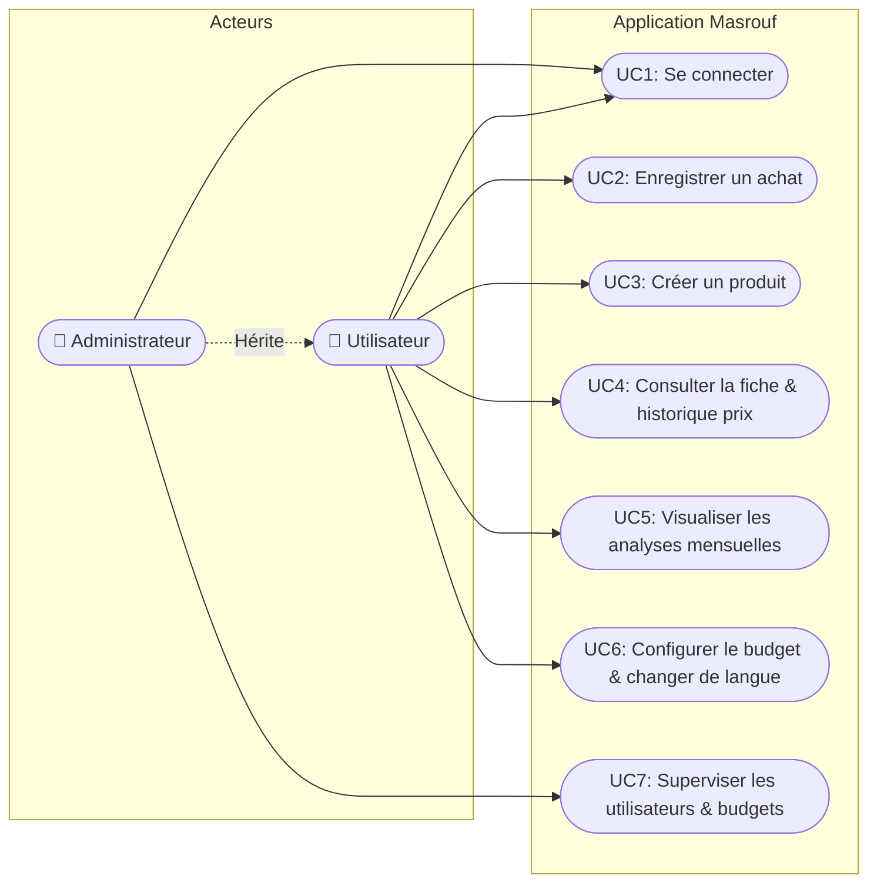
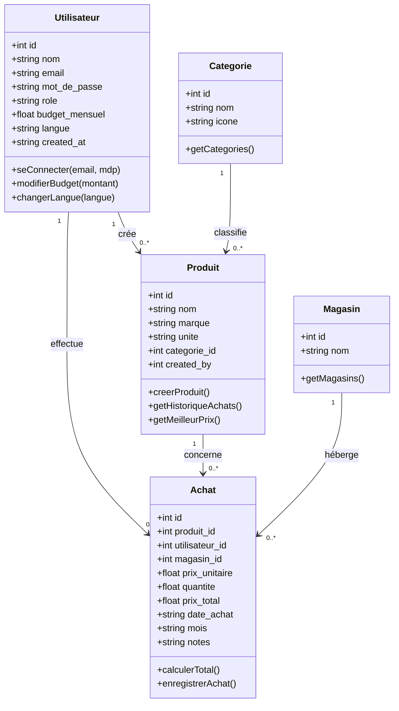
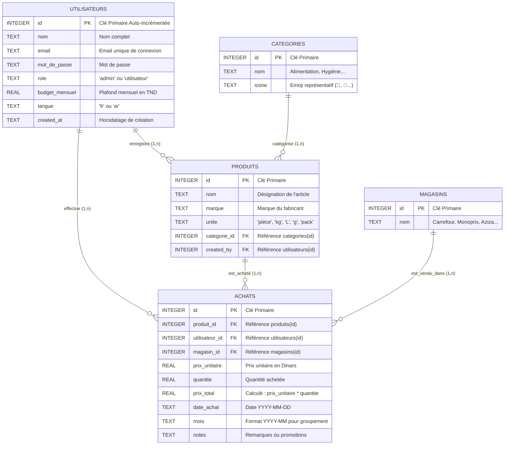

# 📱 Rapport de Projet — Application Mobile « Masrouf » (مصروف)

**Projet de Développement d'Application Mobile React Native**  
**Auteur :** Projet Étudiant  
**Date :** Novembre 2026  
**Technologie :** React Native (Expo SDK 58), TypeScript, SQLite (`expo-sqlite`), Expo Router  

---

## 📑 Sommaire
1. [Description du Sujet du Projet](#1-description-du-sujet-du-projet)
2. [Liste des Utilisateurs (Acteurs)](#2-liste-des-utilisateurs-acteurs)
3. [Spécifications des Cas d'Utilisation (Use Cases)](#3-spécifications-des-cas-dutilisation-use-cases)
4. [Diagramme de Classes](#4-diagramme-de-classes)
5. [Conception de la Base de Données (Modèle Entité-Association)](#5-conception-de-la-base-de-données-modèle-entité-association)
6. [Respect des Critères Évalués](#6-respect-des-critères-évalués)
7. [Fiche de Soutenance Orale (Questions-Réponses avec le Professeur)](#7-fiche-de-soutenance-orale-questions-réponses)

---

## 1. Description du Sujet du Projet

### 1.1 Contexte et Problématique
Dans un contexte où le pouvoir d'achat et la gestion des dépenses domestiques constituent un défi quotidien pour les ménages, le suivi précis des achats de première nécessité est indispensable. Très souvent, les consommateurs oublient le montant exact payé pour un article, ne comparent pas efficacement les tarifs pratiqués entre différentes enseignes (ex : Carrefour, Monoprix, Aziza, MG) et dépassent leur budget mensuel sans préavis.

### 1.2 Objectif de l'Application
**« Masrouf » (مصروف — qui signifie dépense en arabe)** est une application mobile développée sous **React Native** permettant à un foyer de :
1. Définir un **plafond budgétaire mensuel** (en Dinars Tunisiens — TND).
2. Enregistrer rapidement chaque achat avec son prix unitaire, sa quantité et le magasin d'achat.
3. Bénéficier d'**alertes événementielles automatiques** (seuil de 80 % atteint, dépassement du budget).
4. Suivre l'**évolution et la variation des prix** pour chaque produit et détecter automatiquement l'enseigne proposant le **meilleur prix (prix le plus bas)**.
5. Analyser la répartition des dépenses par catégorie et comparer le mois en cours au mois précédent.
6. Supporter l'**internationalisation complète (Français et Arabe)** grâce à un système de ressources qualifiées.
7. Fournir un **espace d'administration** dédié pour superviser les utilisateurs et leurs dépenses.

---

## 2. Liste des Utilisateurs (Acteurs)

L'application intègre un contrôle d'accès basé sur les rôles (**RBAC - Role-Based Access Control**) supportant deux types d'acteurs :

| Acteur | Rôle & Permissions |
|---|---|
| **👤 Utilisateur Régulier (Consommateur)** | - S'authentifie avec son email et mot de passe. - Configure et modifie son propre budget mensuel personnel. - Consulte le catalogue des produits et recherche des articles en temps réel. - Crée de nouveaux produits dans le catalogue. - Enregistre ses achats quotidiens. - Accède à ses analyses mensuelles et graphiques par catégorie. - Bascule la langue de l'interface (Français ↔ Arabe). |
| **👑 Administrateur (Gestionnaire Système)** | - Possède tous les droits de l'utilisateur régulier. - Accède à l'**Espace Administration sécurisé** (`/(admin)`). - Visualise la liste intégrale de tous les comptes utilisateurs inscrits. - Supervise en temps réel le total des dépenses cumulées de tous les membres. - Détecte les utilisateurs en situation de dépassement budgétaire. - Modifie ou réinitialise le budget alloué à n'importe quel utilisateur. |

---

## 3. Spécifications des Cas d'Utilisation (Use Cases)

---

### Spécification Détaillée des Cas d'Utilisation

#### Cas d'Utilisation UC1 : Se connecter (Authentification)
* **Acteur principal :** Utilisateur ou Administrateur.
* **Précondition :** L'application est lancée et la base SQLite est initialisée (`initDatabase`).
* **Scénario nominal :**
  1. L'utilisateur saisit son adresse email et son mot de passe.
  2. Il clique sur le bouton « Se connecter ».
  3. Le système interroge la table SQLite `utilisateurs` via `getUserByEmailPassword()`.
  4. Les identifiants sont validés : l'utilisateur est enregistré dans le contexte global `AuthContext`.
  5. Le système redirige l'utilisateur vers l'écran d'accueil `/(tabs)`.
* **Scénario alternatif (A1 - Identifiants incorrects) :**
  - À l'étape 3, aucun compte ne correspond : le système affiche le message d'erreur rouge « Email ou mot de passe incorrect ». L'utilisateur reste sur la page de connexion.

---

#### Cas d'Utilisation UC2 : Enregistrer un achat
* **Acteur principal :** Utilisateur.
* **Précondition :** L'utilisateur est connecté et au moins un produit existe en base.
* **Scénario nominal :**
  1. L'utilisateur clique sur le bouton « + Achat » depuis l'accueil.
  2. La modale `nouvel-achat.tsx` s'ouvre avec une animation verticale native.
  3. L'utilisateur sélectionne le produit acheté.
  4. L'utilisateur sélectionne le magasin (Carrefour, Monoprix, etc.).
  5. L'utilisateur saisit le prix unitaire et la quantité.
  6. Le système calcule dynamiquement le montant total en temps réel (`Total = Prix × Qté`).
  7. L'utilisateur clique sur « Enregistrer ».
  8. L'achat est inséré dans la table SQLite `achats` via `insertAchat()`.
  9. La modale se ferme ; l'écran d'accueil recalcule automatiquement le budget restant et actualise la barre de progression.
* **Scénario alternatif (A1 - Seuil budgétaire atteint) :**
  - Si le total dépensé dépasse 80 % du budget, un badge orange d'avertissement s'affiche sur le tableau de bord.
  - Si le total dépasse 100 %, un badge rouge de dépassement s'affiche avec la barre virant au rouge.

---

#### Cas d'Utilisation UC3 : Créer un produit
* **Acteur principal :** Utilisateur ou Administrateur.
* **Scénario nominal :**
  1. L'utilisateur clique sur « + Produit ».
  2. La modale `nouveau-produit.tsx` s'ouvre.
  3. L'utilisateur saisit le nom (ex : « Lait demi-écrémé »), la marque (ex : « Délice »), choisit l'unité (L, kg, pièce...) et clique sur l'icône de catégorie appropriée.
  4. L'utilisateur valide.
  5. Le produit est inséré dans SQLite via `insertProduit()`.
  6. Le catalogue des produits se met à jour instantanément.

---

#### Cas d'Utilisation UC4 : Consulter la fiche produit et son historique
* **Acteur principal :** Utilisateur.
* **Scénario nominal :**
  1. Dans l'onglet « Produits », l'utilisateur clique sur un article.
  2. L'application navigue vers la route dynamique `/produit/[id]`.
  3. Le système charge la fiche du produit et exécute une requête SQL pour récupérer l'historique complet des achats passés.
  4. Le système calcule et affiche :
     - Le **meilleur prix historique** et l'enseigne correspondante.
     - Le **prix moyen** pondéré.
     - La liste détaillée de toutes les transactions passées.

---

#### Cas d'Utilisation UC5 : Visualiser les analyses mensuelles
* **Acteur principal :** Utilisateur.
* **Scénario nominal :**
  1. L'utilisateur clique sur l'onglet « Analyses ».
  2. Le système exécute une requête SQL avec agrégation `GROUP BY categorie_id` et `SUM(prix_total)`.
  3. Le système affiche des barres horizontales proportionnelles représentant le pourcentage de chaque catégorie.
  4. Le système compare le total du mois avec celui du mois précédent et calcule l'économie ou le surcoût.

---

#### Cas d'Utilisation UC6 : Configurer le budget et changer de langue
* **Acteur principal :** Utilisateur.
* **Scénario nominal :**
  1. L'utilisateur clique sur l'onglet « Réglages ».
  2. Pour le budget : il saisit un nouveau montant et clique sur « Enregistrer ». La base SQLite et le Contexte React sont mis à jour (`updateBudget`).
  3. Pour la langue : il clique sur « 🇫🇷 Français » ou « 🇸🇦 عربي ». La table SQLite et le Contexte sont mis à jour (`updateLangue`).
  4. Tous les textes de l'application basculent instantanément sans recharger l'application.

---

#### Cas d'Utilisation UC7 : Superviser les utilisateurs (Admin)
* **Acteur principal :** Administrateur.
* **Précondition :** Authentifié avec `role = 'admin'`.
* **Scénario nominal :**
  1. L'administrateur clique sur le bouton supérieur « 👑 Admin ».
  2. Le layout sécurisé `(admin)/_layout.tsx` vérifie le rôle.
  3. L'écran `utilisateurs.tsx` affiche la liste de tous les comptes, leurs budgets et leurs dépenses réelles.
  4. L'admin peut ajuster ou réinitialiser le budget d'un utilisateur directement.

---

## 4. Diagramme de Classes

---

## 5. Conception de la Base de Données (Modèle Entité-Association)

### 5.1 Modèle Entité-Association (Schéma Relationnel)

### 5.2 Description des Tables & Clés
1. **`utilisateurs`** : Stocke les informations des comptes. Clé primaire : `id`. Contrainte `UNIQUE` sur `email`.
2. **`categories`** : Table de référence contenant les types d'articles et leurs émojis visuels.
3. **`produits`** : Catalogue d'articles. Clé étrangère `categorie_id` vers `categories(id)` et `created_by` vers `utilisateurs(id)`.
4. **`magasins`** : Table de référence des enseignes commerciales tunisiennes.
5. **`achats`** : Table centrale des transactions financières. Clés étrangères multiples (`produit_id`, `utilisateur_id`, `magasin_id`). Le champ `mois` (ex : `"2026-11"`) est indexé pour accélérer les calculs d'analyses et les totaux mensuels.

---

## 6. Respect des Critères Évalués

| Critère demandé par le professeur | Implémentation dans le code de Masrouf | Emplacement exact dans le code |
|---|---|---|
| **1. Au moins deux types d'utilisateurs** | Rôle `admin` et rôle `utilisateur` distincts. Espace d'administration dédié avec permissions vérifiées. | `src/utils/auth.tsx` `src/app/(admin)/_layout.tsx` `src/app/(admin)/utilisateurs.tsx` |
| **2. Vues React Native avec Styles** | Utilisation de `View`, `Text`, `ScrollView`, `FlatList`, `KeyboardAvoidingView` stylisées avec `StyleSheet.create`. | Tous les écrans dans `src/app/` |
| **3. Programmation événementielle** | `onPress` (clics boutons), `onChangeText` (saisie temps réel et filtrage), `useFocusEffect` (événements de navigation). | Formulaires `nouvel-achat.tsx`, `nouveau-produit.tsx`, recherche dans `produits.tsx` |
| **4. Bibliothèque externe de navigation** | Navigation par fichiers avec **Expo Router** (basé sur React Navigation) combinant `Stack` et `Tabs`. | `src/app/_layout.tsx` `src/app/(tabs)/_layout.tsx` |
| **5. Ressources avec qualificateurs** | Support multilingue **Français (`fr.json`)** et **Arabe (`ar.json`)** avec détection de la langue de l'utilisateur. | `src/i18n/fr.json` `src/i18n/ar.json` `src/utils/i18n.ts` |
| **6. Connexion à une base de données** | Base relationnelle locale SQLite native avec requêtes `SELECT`, `INSERT`, `UPDATE`, `JOIN` et `GROUP BY`. | `src/db/database.ts` `src/db/queries.ts` |

---

## 7. Fiche de Soutenance Orale (Questions-Réponses)

### Q1 : « Comment fonctionne la navigation dans votre application ? »
> **Réponse :** Nous utilisons **Expo Router**, une bibliothèque externe qui implémente le routage basé sur les fichiers (*file-based routing*). 
> - Le fichier racine `_layout.tsx` crée un **Stack Navigator** (pile d'écrans superposés).
> - Le dossier `(tabs)` regroupe les 4 vues principales sous un **Tabs Navigator** (barre d'onglets du bas).
> - Les fichiers `nouvel-achat.tsx` et `nouveau-produit.tsx` sont configurés avec `presentation: 'modal'` pour glisser verticalement.
> - Le fichier `produit/[id].tsx` représente une **route dynamique** où l'ID du produit est extrait depuis l'URL grâce au hook `useLocalSearchParams()`.

### Q2 : « Où et comment stockez-vous les données ? »
> **Réponse :** Les données sont stockées **localement** sur l'appareil dans une base relationnelle **SQLite** gérée par le package `expo-sqlite`. Le fichier de base s'appelle `masrouf.db`. Au démarrage de l'application, la fonction `initDatabase()` dans `database.ts` crée les 5 tables (`utilisateurs`, `categories`, `produits`, `magasins`, `achats`) si elles n'existent pas déjà (`CREATE TABLE IF NOT EXISTS`) et insère les données de test initiales.

### Q3 : « Expliquez-moi comment vous gérez les deux types d'utilisateurs. »
> **Réponse :** Chaque compte dans la table `utilisateurs` possède un champ `role` valant soit `'admin'`, soit `'utilisateur'`. Lors de la connexion dans `login.tsx`, l'utilisateur authentifié est stocké dans un Contexte React global (`AuthContext`). 
> - Dans la barre d'onglets, si `user.role === 'admin'`, un bouton d'accès rapide « 👑 Admin » apparaît dans l'en-tête.
> - Le sous-dossier `(admin)/_layout.tsx` effectue une vérification de sécurité : si un utilisateur standard tente d'y accéder, il est immédiatement redirigé vers l'accueil.
> - L'écran admin permet de visualiser l'ensemble des comptes et d'ajuster leurs budgets.

### Q4 : « Qu'est-ce qu'une ressource avec qualificateur dans votre projet ? »
> **Réponse :** Dans notre projet, le qualificateur est la **langue** (`fr` ou `ar`). Nous avons externalisé l'ensemble des chaînes de caractères de l'application dans deux fichiers de ressources JSON : `fr.json` (qualifié pour la langue française) et `ar.json` (qualifié pour la langue arabe). Notre hook personnalisé `useTranslation()` lit la langue active de l'utilisateur connecté et charge dynamiquement le dictionnaire approprié grâce à la fonction `t(cle)`.

### Q5 : « Comment réagit l'application aux événements de saisie ? »
> **Réponse :** Nous utilisons les hooks React `useState` et les gestionnaires d'événements :
> - Dans `produits.tsx`, l'événement `onChangeText` sur le champ de recherche filtre la liste des produits en mémoire en temps réel sans recharger la page.
> - Dans `nouvel-achat.tsx`, à chaque modification du prix ou de la quantité, le `Total` se recalcule automatiquement à l'écran.
> - L'événement `useFocusEffect` recharge les données SQLite fraîches dès qu'un écran repasse au premier plan.

