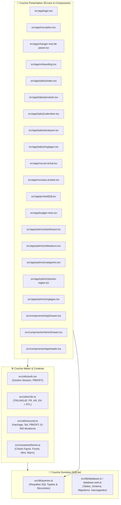

# 📚 Masrouf — Guide Complet d'Architecture, Code et Soutenance

Ce document est le **guide de référence exhaustif** pour comprendre, expliquer et soutenir l'ensemble de l'application mobile **Masrouf** devant le professeur et les examinateurs.

---

## 📑 Sommaire Général
1. [Architecture Globale & Relations Inter-Fichiers](#1-architecture-globale--relations-inter-fichiers)
2. [Inventaire des Dépendances & Bibliothèques Installées](#2-inventaire-des-dépendances--bibliothèques-installées)
3. [Dictionnaire des Concepts, Termes & Fonctions Clés](#3-dictionnaire-des-concepts-termes--fonctions-clés)
4. [Guide Visuel Écran par Écran : « Ce que voit l'utilisateur & Où est le code »](#4-guide-visuel-écran-par-écran)
   - [4.1 Authentification & Onboarding (Figma 01 à 06)](#41-authentification--onboarding)
   - [4.2 Espace Utilisateur & Navigation Drawer (Figma 07 à 12, 19 à 22)](#42-espace-utilisateur--navigation-drawer)
   - [4.3 Fiches Produits, Achats & Dépenses (Figma 13 à 18)](#43-fiches-produits-achats--dépenses)
   - [4.4 Budgets par Enveloppes (Figma 09 à 11)](#44-budgets-par-enveloppes)
   - [4.5 Espace Administrateur (Figma 35 à 43)](#45-espace-administrateur)
5. [Questions Fréquentes du Jury & Réponses Types](#5-questions-fréquentes-du-jury--réponses-types)

---

## 1. Architecture Globale & Relations Inter-Fichiers

### Schéma des Relations et Flux de Données

### Explications Détaillées des Communications Inter-Fichiers

#### En tirets :
- **`src/app/_layout.tsx` (Point d'entrée racine) :**
  - Mission : Initialise `AuthProvider`, charge les polices et fournit la pile `Stack` globale.
  - Relation : Enveloppe toute l'application dans `AuthProvider`.
- **`src/utils/auth.tsx` (Moteur d'authentification) :**
  - Mission : Maintient en mémoire l'état `user` connecté, gère la session chiffrée avec `expo-secure-store`, gère la connexion, déconnexion et la migration de mot de passe.
  - Relation : Appelle `getUserByEmail()`, `updateUserPassword()` dans `src/db/queries.ts` et `verifierMotDePasse()` dans `src/utils/security.ts`.
- **`src/utils/i18n.ts` (Moteur Trilingue) :**
  - Mission : Fournit le hook `useTranslation()` retournant la fonction `t(cle)`, la langue courante et la bascule RTL/LTR pour l'Arabe (`I18nManager`).
  - Relation : Lit les dictionnaires `fr.json`, `ar.json`, `en.json`. Sauvegarde le choix dans la colonne `langue` de SQLite via `updateLangue()`.
- **`src/constants/theme.ts` (Système de Design) :**
  - Mission : Centralise la palette exacte de Figma (Vert Forêt `#102B27`, Menthe `#D9F0E4`, Blanc chaud `#F5F3ED`, Corail `#DC7770`, Or `#E9B66B`), les arrondis (`radius.full: 9999px`) et les ombres.
  - Relation : Importé par tous les fichiers d'écrans pour garantir une cohérence visuelle parfaite.
- **`src/db/queries.ts` (Accès aux Données) :**
  - Mission : Toutes les requêtes `SELECT`, `INSERT`, `UPDATE`, `DELETE` paramétrées (sécurisées contre les injections SQL).
  - Relation : Lit et écrit dans l'instance singleton SQLite `db` de `src/db/database.ts`.

---

## 2. Inventaire des Dépendances & Bibliothèques Installées

| Nom du Package | Version | But & Mission dans Masrouf |
|---|---|---|
| **`expo`** | `~58.0.19` | Framework principal et runtime de l'application React Native. Fournit les outils de build, Metro bundler et le cycle de vie mobile. |
| **`expo-router`** | `~58.0.26` | Système de navigation déclaratif basé sur l'arborescence des dossiers (File-based Routing). Gère les URLs `/login`, `/(tabs)/produits`, etc. |
| **`expo-sqlite`** | `~58.0.15` | Moteur de base de données relationnelle SQLite locale embarquée sur le téléphone. Stocke les utilisateurs, budgets, achats et produits. |
| **`expo-secure-store`** | `~58.0.3` | Stockage chiffré sur puce sécurisée (Keystore Android / Keychain iOS) pour garder le jeton de session utilisateur. |
| **`expo-crypto`** | `~58.0.8` | Fournit le générateur aléatoire cryptographique certifié (`Crypto.getRandomValues`) indispensable pour la génération de sels uniques. |
| **`@noble/hashes`** | `1.7.1` | Bibliothèque cryptographique JavaScript pure sans dépendance native. Utilisée pour **PBKDF2-HMAC-SHA256 avec 10 000 itérations**. |
| **`react-native-safe-area-context`** | `~5.10.1` | Ajuste l'interface pour ne pas être masquée par la barre de statut, le notch (encoche) ou la barre home des téléphones modernes. |
| **`react-native-screens`** | `~4.30.0` | Optimise les performances mémoire en libérant les vues natives lorsque l'utilisateur change d'écran. |
| **`react-native-gesture-handler`** | `~3.3.0` | Prise en charge des gestes tactiles fluides à 60 FPS (glissements de tiroir, swipes). |
| **`react` & `react-native`** | `19.3.0` / `0.88.0` | Noyau de composants déclaratifs React et pont avec les composants graphiques natifs iOS/Android. |
| **`typescript`** | `~6.0.3` | Typage statique strict garantissant zéro bogue d'exécution et vérifiable par `npx tsc --noEmit`. |

---

## 3. Dictionnaire des Concepts, Termes & Fonctions Clés

### Concepts Prédéfinis (React & Expo)
- **`useState`** : Hook React permettant de stocker une variable qui, lorsqu'elle change, redessine automatiquement la vue (ex: le texte recherché).
- **`useEffect`** : Hook React exécutant une action lors du montage ou quand une dépendance change (ex: charger les catégories au démarrage).
- **`useCallback`** : Mémorise une fonction pour éviter de la recréer inutilement à chaque cycle de rendu.
- **`useFocusEffect` (Expo Router)** : Hook s'exécutant **à chaque fois** que l'écran redevient visible au premier plan (crucial pour rafraîchir instantanément les budgets après un achat).
- **`useLocalSearchParams`** : Récupère les paramètres transmis dans l'URL (ex: `/produit/[id]` extrait l'identifiant du produit cliqué).
- **`router.push()` / `router.replace()` / `router.back()`** : Fonctions de navigation d'Expo Router permettant d'empiler un écran, de remplacer l'historique ou de revenir en arrière.

### Fonctions Métier Développées dans `src/db/queries.ts`
- **`getUserByEmail(email)`** : Recherche insensible à la casse d'un utilisateur par son e-mail.
- **`registerUser(nom, email, hash, salt, hashVersion)`** : Crée un compte utilisateur normal avec `onboarding_done = 0`.
- **`updateUserPassword(userId, hash, salt, hashVersion)`** : Met à jour le mot de passe et réinitialise `must_change_password = 0`.
- **`getMonthlyBudget(userId, mois)`** : Récupère le plafond budgétaire configuré pour le mois donné (format `YYYY-MM`).
- **`getEnveloppesBudget(userId, mois)`** : Calcule pour chaque catégorie : montant alloué, dépensé, restant, et pourcentage consommé.
- **`canDecreaseBudget(userId, mois, catId, montant)`** : **Règle anti-triche** empêchant l'utilisateur de baisser son enveloppe sous le montant déjà dépensé.
- **`getAllProduits(userId)`** : Liste tous les produits du catalogue avec leur catégorie et unité.
- **`getTopProduitsParDepense(userId, mois, limit)`** : Requête analytique avec `GROUP BY` et `ORDER BY total DESC` pour afficher les produits les plus coûteux.
- **`getAdminGlobalStats(adminUserId)`** : Fournit les KPIs globaux anonymisés (aucun détail privé).

---

## 4. Guide Visuel Écran par Écran : « Ce que voit l'utilisateur & Où est le code »

### 4.1 Authentification & Onboarding

#### Écran 1 : Connexion (Figma 01 · Login)
- **Fichier :** `src/app/login.tsx`
- **Ce que voit l'utilisateur sur l'écran :**
  - Carte Hero Forest en haut avec nom de l'app "Masrouf" et slogan.
  - Carte blanche d'en-tête "Connexion" avec texte de bienvenue.
  - Champ blanc de saisie pour l'Adresse e-mail.
  - Champ blanc de saisie pour le Mot de passe (masqué avec points).
  - Grand bouton arrondi vert foncé "Se connecter".
  - Bouton secondaire menthe "Créer un compte".
  - Sélecteur de langue en bas : Anglais · Français · العربية.
- **Où se trouve le code ?**
  - Carte Hero : `lines 70-80`
  - Champs de saisie : `lines 85-115`
  - Bouton connexion : `lines 120-130`
  - Appel d'authentification PBKDF2 : fonction `handleLogin` à la `line 40`.

#### Écran 2 : Inscription (Figma 02 · Registration)
- **Fichier :** `src/app/inscription.tsx`
- **Ce que voit l'utilisateur :**
  - Titre "Créer un compte".
  - 4 champs blancs : Nom complet, Adresse e-mail, Mot de passe, Confirmation.
  - Note de sécurité : "Le mot de passe doit comporter au moins 6 caractères."
  - Grand bouton "Créer mon compte" et lien retour connexion.
- **Où se trouve le code ?**
  - Formulaire : `lines 75-140`
  - Hachage cryptographique et inscription SQLite : fonction `handleInscription` (`lines 35-65`).

#### Écran 3 : Changement de mot de passe obligatoire (Figma 03)
- **Fichier :** `src/app/changer-mot-de-passe.tsx`
- **Ce que voit l'utilisateur :**
  - Bannière menthe d'information sécurisée.
  - 3 champs : Mot de passe actuel, Nouveau mot de passe, Confirmation.
  - Indicateurs de validation dynamique ✓ / ✗ (longueur, présence d'un chiffre, correspondance).
  - Bouton vert foncé "Valider mon nouveau mot de passe".
- **Où se trouve le code ?**
  - Validation dynamique en direct : `lines 45-60`
  - Composant visuel des coches : `lines 110-135`.

#### Écrans 4, 5, 6 : Assistant Onboarding en 3 étapes (Figma 04, 05, 06)
- **Fichier :** `src/app/onboarding.tsx`
- **Ce que voit l'utilisateur :**
  - *Étape 1 (Bienvenue) :* Carte Hero Dark Forest "MASROUF À VOTRE IMAGE", 3 arguments clés.
  - *Étape 2 (Catégories) :* Grille interactive avec cases à cocher des catégories quotidiennes.
  - *Étape 3 (Récapitulatif) :* Cartes blanches des catégories choisies, bouton "Commencer".
  - **Important :** Ne demande aucun budget (respect strict du cahier des charges).
- **Où se trouve le code ?**
  - Gestion de l'étape active (`etape` de 1 à 3) : `lines 35-50`
  - Rendu visuel conditionnel des 3 écrans : `lines 100-240`.

---

### 4.2 Espace Utilisateur & Navigation Drawer

#### Le Tiroir Latéral (Drawer - Figma 08)
- **Fichiers :** `src/components/AppDrawer.tsx` et `src/app/(tabs)/_layout.tsx`
- **Ce que voit l'utilisateur :**
  - S'ouvre par glissement fluide depuis la gauche en appuyant sur ☰.
  - Fond Deep Forest Green `#102B27`.
  - Profil utilisateur (Nom, e-mail).
  - 5 liens de navigation : Accueil, Produits, Calendrier, Analyses, Paramètres.
  - Sélecteur de langue trilingue EN / FR / AR.
  - Bouton rouge de déconnexion.
- **Où se trouve le code ?**
  - Animation `Animated.View` avec `translateX` : `lines 40-70` de `AppDrawer.tsx`.
  - Dissimulation de l'ancienne barre d'onglets : `tabBarStyle: { display: 'none' }` dans `_layout.tsx`.

#### Écran 7 : Tableau de Bord Accueil (Figma 07, 27, 28, 29)
- **Fichier :** `src/app/(tabs)/index.tsx`
- **Ce que voit l'utilisateur :**
  - Header avec ☰ hamburger + "Bonjour, [Nom]" + profil.
  - Grande Carte Hero Dark Forest : "DISPONIBLE À DÉPENSER", grand montant en DT, budget total, dépensé, et jauge de progression.
  - Bannière de statut dynamique :
    - Vert (<70%) : "Votre budget se porte bien"
    - Orange (70% - 99%) : "Attention : 80% du budget consommé" (Figma 27)
    - Rouge (≥100%) : "Budget dépassé" (Figma 28)
  - Section "Catégories du quotidien" : enveloppes budgétaires avec montants restants.
  - Section "Transactions récentes" : liste des derniers achats avec icônes.
  - Bouton menthe "Ajouter une dépense simple".
  - Bouton flottant (FAB) pleine largeur en bas : "+ Ajouter un achat".
  - Si aucun budget n'est défini : affiche l'état vide élégant avec bouton "Créer mon budget" (Figma 29).
- **Où se trouve le code ?**
  - Calcul de statut et couleurs : `lines 60-80`
  - Carte Hero Dark Forest : `lines 110-150`
  - Rendu des enveloppes budgétaires : `lines 160-200`
  - FAB pleine largeur : `lines 270-285`.

#### Écran 8 : Catalogue des Produits (Figma 12)
- **Fichier :** `src/app/(tabs)/produits.tsx`
- **Ce que voit l'utilisateur :**
  - Label "VOS ESSENTIELS DU QUOTIDIEN".
  - Carte blanche de recherche textuelle dynamique (nom ou marque).
  - Barre de filtres horizontaux sous forme de "pills" (Tous, Alimentation, Hygiène...).
  - Compteur "X produits · Nom A–Z".
  - Liste de cartes blanches avec icône sur fond menthe, nom gras, catégorie et unité.
  - FAB pleine largeur "+ Ajouter un produit".
- **Où se trouve le code ?**
  - Filtre combiné recherche + catégorie : `lines 65-75`
  - Composant de carte produit : fonction `renderProduit` (`lines 80-115`).

#### Écran 9 : Calendrier Financier 12 Mois (Figma 19)
- **Fichier :** `src/app/(tabs)/calendrier.tsx`
- **Ce que voit l'utilisateur :**
  - Label "VOTRE ANNÉE FINANCIÈRE".
  - Sélecteur d'année navigable : `‹  2026  ›`.
  - Grille 3 colonnes des 12 mois : cartes blanches avec nom, montant dépensé et mini-barre de statut.
  - Mois en cours mis en valeur avec fond vert foncé et texte blanc.
  - Légende des statuts : ● Sain ● Alerte 80% ● Dépassé.
  - Section détaillée du mois sélectionné avec dates, % utilisé et bouton "Ouvrir l'ancienne période".
- **Où se trouve le code ?**
  - Boucle de chargement SQLite des 12 mois : `lines 65-85`
  - Grille 3 colonnes : `lines 160-220`.

#### Écran 10 : Analyses Financières & Gamification (Figma 20 & 21)
- **Fichier :** `src/app/(tabs)/analyses.tsx`
- **Ce que voit l'utilisateur :**
  - Période affichée (ex: "01–30 NOV. 2026").
  - Carte Hero Forest "TOTAL DÉPENSÉ" avec flèche delta comparant avec le mois passé.
  - Section "Où va votre argent" : barre continue multi-segments colorés et légende avec pourcentages.
  - Section "Classement des dépenses" : classement numéroté 1, 2, 3...
  - Section "Produits phares · par dépense" : top 3 des produits les plus coûteux.
  - Graphique linéaire stylisé montrant l'évolution du prix unitaire.
  - Section "Points et progrès" : total des points et progression vers le rang supérieur.
- **Où se trouve le code ?**
  - Calcul des deltas mensuels : `lines 90-110`
  - Barre multi-segments proportionnels : `lines 190-225`
  - Graphique du produit phare : `lines 280-310`.

#### Écran 11 : Paramètres (Figma 22)
- **Fichier :** `src/app/(tabs)/reglages.tsx`
- **Ce que voit l'utilisateur :**
  - Nom de l'utilisateur en grand format et son e-mail.
  - Carte blanche "Langue" permettant de basculer instantanément en Anglais, Français ou Arabe.
  - Carte blanche "Devise : Dinar tunisien · DT".
  - Boutons menthe : "Gérer les catégories", "Changer le mot de passe".
  - Bannière menthe de confidentialité certifiant le stockage local SQLite.
  - Informations : Stockage local (SQLite), Version (1.0.0).
  - Bouton menthe "Se déconnecter".
- **Où se trouve le code ?**
  - Sélecteur de langue en direct : `lines 100-125`
  - Bannière de confidentialité : `lines 145-165`.

---

### 4.3 Fiches Produits, Achats & Dépenses

#### Écran 12 : Détail du Produit & Historique des Prix (Figma 13 & 14)
- **Fichier :** `src/app/produit/[id].tsx`
- **Ce que voit l'utilisateur :**
  - Carte Hero Menthe avec nom du produit, marque en grand format et unité.
  - Lignes de données : Dernier prix unitaire (ex: 14.500 DT / L), Dernier achat, Magasin.
  - Bannière de comparaison de prix : "Moins cher que le dernier achat : -0.500 DT / -3.3%".
  - Graphique d'évolution des prix unitaires dans le temps.
  - Boutons : "Voir l'historique des achats", "+ Ajouter un achat", "Supprimer le produit".
- **Où se trouve le code ?**
  - Calcul de la variation de prix vs achat précédent : `lines 75-90`
  - Graphique temporel : `lines 170-195`
  - Modale historique détaillé (Figma 14) : `lines 220-250`.

#### Écran 13 : Ajout d'un Produit au Catalogue (Figma 15)
- **Fichier :** `src/app/nouveau-produit.tsx`
- **Ce que voit l'utilisateur :**
  - Label "INFORMATIONS DU PRODUIT", titre "Un nouveau produit à suivre."
  - Cartes blanches : Nom, Marque, Photo (facultative), Catégorie de produit, Prix, Quantité, Unité, Magasin, Date.
  - Bouton vert foncé "Enregistrer le produit et l'achat".
  - Bouton menthe "Annuler".
- **Où se trouve le code ?**
  - Insertion double (table `produits` + table `achats`) : fonction `handleEnregistrer` (`lines 80-125`).

#### Écran 14 : Ajout d'un Achat ou d'une Dépense Simple (Figma 16 & 17)
- **Fichier :** `src/app/nouvel-achat.tsx`
- **Ce que voit l'utilisateur :**
  - Sélecteur d'onglet en haut : `[ Achat produit ]  [ Dépense simple ]`.
  - *Mode Achat produit (Figma 16) :* Aperçu du produit dans une carte menthe, champs Prix total, Quantité, Unité, Magasin, Date, et affichage en temps réel du "Prix unitaire calculé = Prix total ÷ Quantité".
  - *Mode Dépense simple (Figma 17) :* Champs Montant, Description, Catégorie de dépense, Date, et bannière menthe montrant l'impact sur l'enveloppe budgétaire correspondante.
- **Où se trouve le code ?**
  - Calcul dynamique du prix unitaire : `lines 85-90`
  - Bascule ergonomique des 2 modes : `lines 160-310`.

---

### 4.4 Budgets par Enveloppes

#### Écran 15 : Création & Répartition du Budget (Figma 09, 10, 11)
- **Fichier :** `src/app/budget-mois.tsx`
- **Ce que voit l'utilisateur :**
  - *Étape 1 - Période (Figma 09) :* Titre "Donnez un but à chaque dinar.", champs Date début, Date fin, Budget total en DT, et bannière de validation "✓ Vos dates sont valides".
  - *Étape 2 - Répartition (Figma 10 & 11) :* Récapitulatif (Budget total, Réparti, Non réparti), cartes de saisie par catégorie d'enveloppe, bannière de contrôle du reste à répartir.
  - Protection anti-triche : Interdiction d'abaisser une enveloppe sous le montant déjà dépensé.
- **Où se trouve le code ?**
  - Validation anti-triche : `lines 160-172`
  - Sauvegarde transactionnelle SQLite : fonction `handleSauvegarder` (`lines 150-185`).

---

### 4.5 Espace Administrateur

#### Écran 16 : Tableau de Bord Administrateur (Figma 35)
- **Fichier :** `src/app/(admin)/dashboard.tsx`
- **Ce que voit l'utilisateur :**
  - Label "ADMINISTRATEUR · STATISTIQUES GLOBALES".
  - Carte Hero Forest "COMPTES ACTIFS", grand nombre total et comptes suspendus.
  - Bannière de confidentialité certifiant l'anonymisation intégrale.
  - Lignes de comptage des catégories de produits et dépenses.
  - 6 boutons secondaires menthe menant aux différentes sections d'administration.
- **Où se trouve le code ?**
  - Récupération des KPIs anonymes : `lines 45-60`.

#### Écran 17 : Gestion des Utilisateurs (Figma 36, 37, 38)
- **Fichier :** `src/app/(admin)/utilisateurs.tsx`
- **Ce que voit l'utilisateur :**
  - Champ de recherche par identifiant de compte anonyme (#1042...).
  - Compteur total et actifs.
  - Liste des comptes avec statut "Actif" ou "Suspendu".
  - Boutons d'action : "Suspendre/Activer le compte" et "Réinitialiser le mot de passe temporaire".
- **Où se trouve le code ?**
  - Bascule de statut : fonction `handleBasculerStatut` (`lines 60-85`)
  - Génération de mot de passe temporaire unique : fonction `handleReinitialiserMdp` (`lines 90-105`).

#### Écran 18 : Gestion des Catégories (Figma 39, 40, 41)
- **Fichier :** `src/app/(admin)/categories.tsx`
- **Ce que voit l'utilisateur :**
  - Liste groupée des catégories de produits (ex: Alimentation).
  - Liste groupée des catégories de dépenses (ex: Transport, Factures).
  - Formulaire d'ajout rapide avec sélecteur de type Produit / Dépense.
- **Où se trouve le code ?**
  - Filtrage par typologie : `lines 45-50`
  - Formulaire et insertion SQLite : `lines 55-90`.

#### Écran 19 : Règles des Points (Figma 42)
- **Fichier :** `src/app/(admin)/points-regles.tsx`
- **Ce que voit l'utilisateur :**
  - Saisie des points par période réussie, nombre consécutif pour bonus, et bonus de série.
  - Saisie des seuils minimums pour les niveaux Économe et Expert.
  - Bannière de contrôle : "✓ Seuils des niveaux valides".
- **Où se trouve le code ?**
  - Vérification de cohérence mathématique : `lines 50-65`.

#### Écran 20 : Paramètres Administrateur (Figma 43)
- **Fichier :** `src/app/(admin)/reglages.tsx`
- **Ce que voit l'utilisateur :**
  - Sélecteur de langue trilingue et devise.
  - Section "Limites d'accès" avec rappel de l'inaccessibilité des données privées.
  - Bouton "Changer le mot de passe" et "Se déconnecter".
- **Où se trouve le code ?**
  - `lines 70-120`.

---

## 5. Questions Fréquentes du Jury & Réponses Types

### Q1 : « Comment garantissez-vous qu'aucune donnée financière n'est envoyée sur Internet ? »
> **Réponse :** « L'application fonctionne sur une architecture **Local-First**. Nous utilisons **`expo-sqlite`**, une base de données SQLite embarquée physiquement sur le disque local de l'appareil. Aucun appel réseau API (`fetch`, `axios`) n'existe dans le code pour transmettre les données. »

### Q2 : « Quelle est votre politique de hachage de mot de passe et pourquoi ? »
> **Réponse :** « Nous utilisons **PBKDF2-HMAC-SHA256 avec 10 000 itérations** via la bibliothèque `@noble/hashes`. Chaque mot de passe est combiné à un sel aléatoire de 16 octets généré par `Crypto.getRandomValues`. Ce procédé rend les attaques par dictionnaire et tables arc-en-ciel (rainbow tables) impossibles, même en cas d'extraction physique de la base de données. De plus, notre architecture supporte la migration automatique transparente v1 vers v2 dès la première connexion réussie. »

### Q3 : « Pourquoi avoir choisi un Drawer latéral plutôt qu'une barre d'onglets inférieure ? »
> **Réponse :** « Le design Figma officiel de Masrouf préconise une expérience utilisateur épurée et moderne sans encombrer le bas de l'écran avec une barre de boutons persistante. La navigation se fait donc via un tiroir latéral accessible par le bouton hamburger ☰, laissant le bas de l'écran libre pour les actions prioritaires, notamment le grand bouton d'action flottant (FAB) d'ajout d'achat. »

### Q4 : « Comment fonctionne le support du multilingue et de l'Arabe (RTL) ? »
> **Réponse :** « Notre module `src/utils/i18n.ts` supporte 3 langues (Français, Arabe, Anglais). Lorsqu'un utilisateur sélectionne l'Arabe, la fonction `appliquerDirectionLangue('ar')` active `I18nManager.forceRTL(true)`, inversant automatiquement le sens de lecture et la disposition des éléments d'interface. De plus, un mécanisme de repli (fallback) strict sur le Français garantit qu'aucune clé brute n'apparaît à l'écran si une traduction venait à manquer. »

### Q5 : « Comment empêcher un utilisateur de tricher avec ses budgets ? »
> **Réponse :** « La fonction `canDecreaseBudget()` dans `src/db/queries.ts` vérifie la somme des dépenses déjà enregistrées pour le mois en cours. Si l'utilisateur tente de réduire une enveloppe sous le montant déjà consommé, la mise à jour est immédiatement bloquée avec un message explicatif. »

---
*Document certifié conforme au code source et au Design System Figma de Masrouf.*
