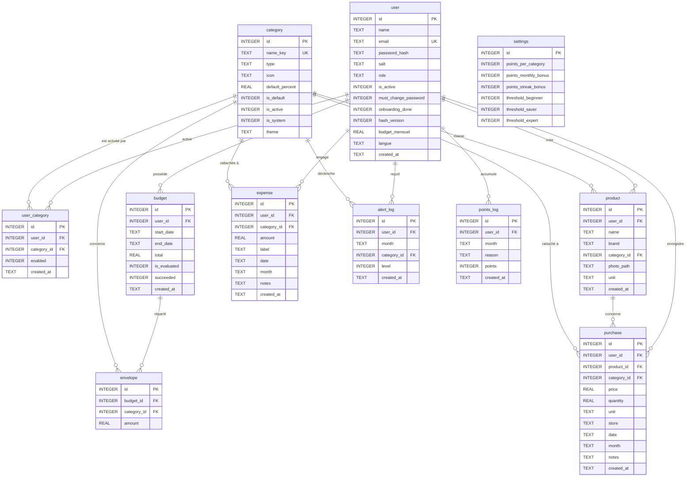

# 🗄️ Masrouf — Schéma Relationnel de la Base de Données (SQLite)

Ce document présente l'architecture complète de la base de données SQLite locale de l'application **Masrouf (مصروف)**.

---

## 1. Diagramme Entité-Association (Mermaid ERD)

---

## 2. Dictionnaire des Tables

### Table `user` (Utilisateurs et Administrateurs)
- `id` (INTEGER, PK, AUTOINCREMENT) : Identifiant unique de l'utilisateur.
- `name` (TEXT, NOT NULL) : Nom complet ou pseudonyme affiché.
- `email` (TEXT, NOT NULL, UNIQUE, NOCASE) : Adresse e-mail (insensible à la casse).
- `password_hash` (TEXT, NOT NULL) : Empreinte cryptographique au format `sel_hex:hash_hex`.
- `salt` (TEXT, NOT NULL) : Sel cryptographique aléatoire de 16 octets généré par `expo-crypto`.
- `role` (TEXT, NOT NULL) : Rôle d'accès : `'admin'` ou `'user'`.
- `is_active` (INTEGER, NOT NULL, DEFAULT 1) : Statut du compte (1 = Actif, 0 = Suspendu).
- `must_change_password` (INTEGER, NOT NULL, DEFAULT 0) : Forcer le renouvellement au prochain login (1 = Obligatoire).
- `onboarding_done` (INTEGER, NOT NULL, DEFAULT 0) : Statut de l'assistant de premier démarrage (0 = À faire, 1 = Fait).
- `hash_version` (INTEGER, NOT NULL, DEFAULT 1) : Version de l'algorithme (1 = SHA-256 simple, 2 = PBKDF2 10 000 itérations).
- `budget_mensuel` (REAL, NOT NULL, DEFAULT 0) : Budget mensuel global indicatif (en TND).
- `langue` (TEXT, NOT NULL, DEFAULT 'fr') : Préférence linguistique (`'fr'`, `'ar'`, `'en'`).
- `created_at` (TEXT, NOT NULL) : Horodatage ISO de création.

### Table `category` (Référentiel des Catégories)
- `id` (INTEGER, PK, AUTOINCREMENT) : Identifiant unique de la catégorie.
- `name_key` (TEXT, NOT NULL, UNIQUE, NOCASE) : Clé de nom (utilisée pour l'i18n ou nom personnalisé).
- `type` (TEXT, NOT NULL, CHECK(`'product'` OU `'expense'`)) : Nature des articles :
  - `'product'` : Articles achetables au détail (supermarché, quantité, unité).
  - `'expense'` : Dépenses directes et factures (services fixes, STEG, transport).
- `icon` (TEXT, NOT NULL, DEFAULT '📦') : Emoji ou glyphe visuel représentatif.
- `default_percent` (REAL, NOT NULL, DEFAULT 0) : Pourcentage alloué par défaut lors de la création d'un premier budget.
- `is_default` (INTEGER, NOT NULL, DEFAULT 0) : 1 si la catégorie fait partie des catégories initiales.
- `is_active` (INTEGER, NOT NULL, DEFAULT 1) : 1 si la catégorie est active et visible.
- `is_system` (INTEGER, NOT NULL, DEFAULT 0) : 1 si la catégorie est protégée (ex: `'Autres'`, insupprimable).
- `theme` (TEXT, NOT NULL) : Regroupement thématique (Essentiel, Vie quotidienne, Logement...).

### Table `product` (Catalogue d'Articles)
- `id` (INTEGER, PK, AUTOINCREMENT) : Identifiant de l'article.
- `user_id` (INTEGER, NOT NULL, FK `user(id)` ON DELETE CASCADE) : Propriétaire de l'article.
- `name` (TEXT, NOT NULL) : Nom du produit (ex: "Lait demi-écrémé").
- `brand` (TEXT, NOT NULL, DEFAULT '') : Marque commerciale (ex: "Délice").
- `category_id` (INTEGER, NOT NULL, FK `category(id)` ON DELETE CASCADE) : Catégorie parente.
- `photo_path` (TEXT, NOT NULL, DEFAULT '') : Chemin URI local de la photo.
- `unit` (TEXT, NOT NULL, DEFAULT 'pièce') : Unité de mesure (`'pièce'`, `'kg'`, `'L'`, `'g'`, `'pack'`).
- `created_at` (TEXT, NOT NULL) : Date de création.

### Table `purchase` (Achats de Produits au Détail)
- `id` (INTEGER, PK, AUTOINCREMENT) : Identifiant du ticket d'achat.
- `user_id` (INTEGER, NOT NULL, FK `user(id)` ON DELETE CASCADE) : Utilisateur acheteur.
- `product_id` (INTEGER, NOT NULL, FK `product(id)` ON DELETE CASCADE) : Produit acheté.
- `category_id` (INTEGER, NOT NULL, FK `category(id)` ON DELETE CASCADE) : Catégorie budgétaire impactée.
- `price` (REAL, NOT NULL) : Prix TOTAL de la ligne (en TND). Le prix unitaire se calcule : price / quantity. L'ancienne base stockait l'unitaire ; la migration `purchase_price_is_total_v1` multiplie une seule fois par la quantité après avoir lu les lignes.
- `quantity` (REAL, NOT NULL, DEFAULT 1) : Quantité achetée.
- `unit` (TEXT, NOT NULL) : Unité au moment de l'achat.
- `store` (TEXT, NOT NULL) : Enseigne ou magasin d'achat (ex: "Carrefour", "Monoprix", "Épicerie").
- `date` (TEXT, NOT NULL) : Date d'achat (format `YYYY-MM-DD`).
- `month` (TEXT, NOT NULL) : Mois comptable rattaché (format `YYYY-MM`).
- `notes` (TEXT, NOT NULL, DEFAULT '') : Remarques ou détails textuels.
- `created_at` (TEXT, NOT NULL) : Horodatage d'enregistrement.

### Table `expense` (Dépenses Directes Hors Catalogue)
- `id` (INTEGER, PK, AUTOINCREMENT) : Identifiant de la dépense.
- `user_id` (INTEGER, NOT NULL, FK `user(id)` ON DELETE CASCADE) : Utilisateur payeur.
- `category_id` (INTEGER, NOT NULL, FK `category(id)` ON DELETE CASCADE) : Catégorie de dépense.
- `amount` (REAL, NOT NULL) : Montant total débité (en TND).
- `label` (TEXT, NOT NULL) : Libellé de la dépense (ex: "Facture STEG", "Taxi").
- `date` (TEXT, NOT NULL) : Date de la dépense.
- `month` (TEXT, NOT NULL) : Mois comptable rattaché (`YYYY-MM`).
- `notes` (TEXT, NOT NULL, DEFAULT '') : Commentaires.
- `created_at` (TEXT, NOT NULL) : Horodatage d'enregistrement.

### Table `budget` et `envelope` (période libre)
- `budget` : une période choisie (`start_date`, `end_date`, `total`). Deux périodes du même utilisateur ne se chevauchent pas. `is_evaluated` empêche de donner les points deux fois. `succeeded` vaut 1 si les dépenses sont restées dans le total.
- `envelope` : montant alloué à une catégorie pour cette période. La somme des enveloppes ne dépasse pas `budget.total`. Le reste non réparti est autorisé.
- Les anciennes tables `month_budget` et `category_budget` sont encore lues une fois par la migration, qui crée une période du 1er au dernier jour du mois. Elles ne servent plus aux écrans.

### Table `alert_log` (Journal Anti-Répétition des Alertes)
- Enregistre chaque alerte franchie (80% ou 100%) par utilisateur, mois et catégorie pour éviter d'inonder l'utilisateur de messages répétitifs.

### Table `points_log` & `settings` (Gamification)
- `points_log` : Historique des points gagnés lors de la clôture mensuelle des budgets.
- `settings` : Barème des points (bonus mensuel, bonus série, seuils Débutant, Économe, Expert).

---

## 3. Vues et Triggers de Compatibilité (Rétrocompatibilité Totale)
Pour assurer une compatibilité absolue avec l'historique du code et éviter toute régression :
- `utilisateurs` : Vue miroir sur `user` avec triggers `INSTEAD OF INSERT/UPDATE/DELETE`.
- `categories` : Vue miroir sur `category` avec triggers `INSTEAD OF INSERT/UPDATE/DELETE`.
- `produits` : Vue miroir sur `product` avec triggers `INSTEAD OF INSERT/UPDATE/DELETE`.
- `achats` : Vue unifiée combinant `purchase` (achats avec produits) et `expense` (dépenses directes) via `UNION ALL`, avec triggers d'insertion automatique vers la bonne table.
- `monthly_budgets` & `category_budgets` : Vues miroirs sur `month_budget` et `category_budget`.

