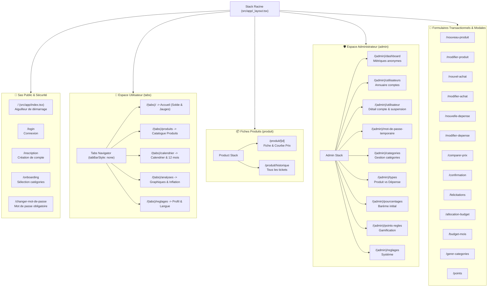

# 🧭 ARCHITECTURE COMPLÈTE DE LA NAVIGATION DANS MASROUF
> **Guide Pédagogique Intégral — De Zéro jusqu'à la Maîtrise Orale**  
> **Technologies :** Expo 58, Expo Router 58, React Navigation, React Native 0.88, SQLite (`expo-sqlite`), TypeScript  
> **Objectif :** Comprendre 100% de la navigation de l'application Masrouf, justifier chaque choix d'ingénierie et répondre avec brio aux questions du professeur lors de la soutenance orale.

---

## SOMMAIRE
1. [ÉTAPE 1 : Ce que contient réellement le projet (Inspection terrain)](#étape-1--ce-que-contient-réellement-le-projet-inspection-terrain)
2. [ÉTAPE 2 : L'arbre de navigation réel (Schéma & Découpage)](#étape-2--larbre-de-navigation-réel-schéma--découpage)
3. [ÉTAPE 3 : Le POURQUOI de chaque choix d'architecture](#étape-3--le-pourquoi-de-chaque-choix-darchitecture)
4. [ÉTAPE 4 : Le COMMENT en pratique (Code réel, Méthodes & Comportements)](#étape-4--le-comment-en-pratique-code-réel-méthodes--comportements)
5. [ÉTAPE 5 : Trois parcours utilisateurs complets pas à pas](#étape-5--trois-parcours-utilisateurs-complets-pas-à-pas)
6. [ÉTAPE 6 : Audit critique — Particularités, Risques et Cohérence](#étape-6--audit-critique--particularités-risques-et-cohérence)
7. [ÉTAPE 7 : Tableau récapitulatif, Questions d'examen oral & Lexique](#étape-7--tableau-récapitulatif-questions-dexamen-oral--lexique)

---

# ÉTAPE 1 : Ce que contient réellement le projet (Inspection terrain)

Contrairement aux tutoriels classiques React Native ou aux projets plus anciens, ce projet utilise les toutes dernières normes d'Expo. Voici ce qui est **réellement** présent dans le code source :

### 1. Le champ `"main"` dans `package.json`
Dans `masrouf/package.json` :
```json
{
  "name": "masrouf",
  "version": "1.0.0",
  "main": "expo-router/entry"
}
```
* **Ce que cela signifie :** Le point d'entrée officiel de l'application n'est **pas** un fichier JavaScript classique. La valeur `"expo-router/entry"` indique à Expo de confier le démarrage au moteur d'**Expo Router**, qui va automatiquement chercher le dossier `src/app/` pour construire l'arbre de navigation.

### 2. Est-ce que `App.tsx` existe ?
* **Réponse : NON.** Ni `masrouf/App.tsx`, ni `masrouf/src/App.tsx` n'existent dans le projet.
* **Pourquoi ?** Dans l'ancienne version de React Native (React Navigation classique), `App.tsx` servait de gros fichier monolithique où l'on devait déclarer manuellement chaque écran, chaque barre de navigation et chaque lien. Avec Expo Router, le fichier racine s'appelle obligatoirement **`src/app/_layout.tsx`**.

### 3. Les dossiers existants et inexistants dans `src/`
Lors de l'inspection de l'arborescence, voici ce que l'on trouve :

| Dossier | Existe ? | Rôle dans Masrouf | Que se passe-t-il si on le supprime ? |
| :--- | :---: | :--- | :--- |
| **`src/app/`** | **OUI** | **Le cœur du routage.** Chaque fichier `.tsx` dans ce dossier correspond automatiquement à un écran de l'application (routage par fichiers). | **L'application plante complètement au démarrage.** Plus aucun écran ne peut être trouvé ni affiché. |
| **`src/components/`** | **OUI** | Contient les composants réutilisables, les formulaires métier (`PurchaseForm`, `ExpenseForm`), l'en-tête universel (`AppHeader`), le gabarit d'écran (`Screen`) et **tout le système de menu tiroir** (`DrawerHost`, `DrawerContext`, `SideDrawer`, `AppDrawer`, `AdminDrawer`). | Les écrans perdent leur barre de titre, leur tiroir coulissant, leurs boutons et formulaires. Les écrans ne compileront plus. |
| **`src/screens/`** | **NON** | Inexistant dans ce projet. | *Rien*, car les écrans sont directement placés dans `src/app/`. |
| **`src/navigation/`** | **NON** | Inexistant dans ce projet. | *Rien*, car la navigation est entièrement pilotée par les fichiers `_layout.tsx` d'Expo Router et les composants de tiroir dans `src/components/`. |
| **`src/state/`** | **OUI** | Contient le Store React global (`store.tsx`), la passerelle SQLite (`sqlite-bridge.ts`) et les sélecteurs de calcul financier (`selectors.ts`). | L'application ne peut plus retenir qui est connecté, ni lire ou écrire les budgets et transactions en mémoire. |
| **`src/db/`** | **OUI** | Contient la connexion SQLite locale physique `masrouf.db` (`database.ts`), les migrations (`migrate.ts`) et le catalogue de requêtes SQL (`queries.ts`). | Toutes les données physiques (utilisateurs, dépenses, catégories) disparaissent. L'app perd son stockage 100% hors-ligne. |
| **`src/utils/`** | **OUI** | Contient la sécurité (hachage SHA-256), la session (`session.ts`), l'internationalisation trilingue (`i18n.ts`) et la gestion des photos/caméra (`photos.ts`). | Le contrôle de mot de passe, les traductions et l'aiguillage de session (`homeRouteFor`) cessent de fonctionner. |

### 4. L'arborescence complète de `src/app/` et les 4 `_layout.tsx`
Le dossier `src/app/` contient **4 fichiers `_layout.tsx`** qui définissent 4 niveaux d'encapsulation :

```text
src/app/
├── _layout.tsx                 <-- 1. ROOT LAYOUT : Stack racine, Contexte SQLite, Sécurité (Gate), Tiroir (DrawerHost)
├── index.tsx                   <-- Aiguillage initial (Redirige vers /login, /(tabs) ou /(admin))
├── login.tsx                   <-- Écran d'authentification
├── inscription.tsx             <-- Écran de création de compte
├── onboarding.tsx              <-- Assistant de bienvenue (sélection des catégories initiales)
├── changer-mot-de-passe.tsx    <-- Écran forcé (mot de passe temporaire) ou volontaire
│
├── (tabs)/                     <-- GROUPE UTILISATEUR NORMAL (Onglets cachés + Tiroir)
│   ├── _layout.tsx             <-- 2. TABS LAYOUT : <Tabs> avec tabBarStyle caché pour afficher le SideDrawer
│   ├── index.tsx               <-- Tableau de bord financier (Reste à vivre, jauges, dépenses récentes)
│   ├── produits.tsx            <-- Répertoire des articles et suivi d'inflation
│   ├── calendrier.tsx          <-- Calendrier des dépenses et matrice des 12 mois
│   ├── analyses.tsx            <-- Graphiques, répartition et comparaisons
│   └── reglages.tsx            <-- Profil personnel, choix de langue, réinitialisation
│
├── produit/                    <-- GROUPE FICHES PRODUITS
│   ├── _layout.tsx             <-- 3. PRODUCT LAYOUT : <Stack> dédiée à la consultation des détails d'un article
│   ├── [id].tsx                <-- Route dynamique : Fiche détaillée de l'article selon son identifiant unique
│   └── historique.tsx          <-- Journal chronologique de tous les achats passés de cet article
│
├── (admin)/                    <-- GROUPE SUPERVISION ADMINISTRATEUR
│   ├── _layout.tsx             <-- 4. ADMIN LAYOUT : <Stack> dédiée aux fonctions de gestion système
│   ├── dashboard.tsx           <-- Vue d'ensemble et métriques globales anonymes
│   ├── utilisateurs.tsx        <-- Annuaire de tous les comptes enregistrés
│   ├── utilisateur.tsx         <-- Fiche d'un compte (activer/suspendre, mot de passe temporaire)
│   ├── mot-de-passe-temporaire.tsx <-- Affichage sécurisé du mot de passe temporaire généré
│   ├── categories.tsx          <-- Gestion des catégories (ajout, masquage, protection)
│   ├── types.tsx               <-- Typage des catégories (Produit vs Dépense)
│   ├── pourcentages.tsx        <-- Répartition budgétaire recommandée par défaut
│   ├── points-regles.tsx       <-- Barème des points et seuils de gamification
│   └── reglages.tsx            <-- Paramètres généraux de la plateforme
│
└── FORMULAIRES & MODALES (Écrans de pile plein écran au-dessus des onglets) :
    ├── nouveau-produit.tsx     <-- Création d'un article d'épicerie
    ├── modifier-produit.tsx    <-- Édition d'un article existant
    ├── nouvel-achat.tsx        <-- Saisie d'un ticket de caisse avec prix, quantité, magasin
    ├── modifier-achat.tsx      <-- Rectification d'un achat
    ├── nouvelle-depense.tsx    <-- Dépense forfaitaire sans produit (loyer, facture, etc.)
    ├── modifier-depense.tsx    <-- Rectification d'une dépense directe
    ├── comparer-prix.tsx       <-- Comparateur d'inflation avant enregistrement définitif
    ├── confirmation.tsx        <-- Écran vert de succès après enregistrement d'une transaction
    ├── felicitations.tsx       <-- Célébration d'un budget respecté avec attribution de points
    ├── allocation-budget.tsx   <-- Répartition des enveloppes budgétaires
    ├── budget-mois.tsx         <-- Définition du montant global et de la période du budget
    ├── gerer-categories.tsx    <-- Activation/Désactivation des catégories de l'utilisateur
    └── points.tsx              <-- Historique complet des points, badges et séries
```

---

# ÉTAPE 2 : L'arbre de navigation réel (Schéma & Découpage)

### 1. Schéma visuel de la navigation



### 2. Pourquoi certains écrans sont DANS `(tabs)` et d'autres DEHORS ?

* **Ce qui est DANS `(tabs)` (5 écrans) :**  
  `index`, `produits`, `calendrier`, `analyses`, `reglages`.  
  **Raison technique :** Ce sont les 5 vues principales récurrentes de l'utilisateur. En les mettant dans un conteneur `Tabs`, React Navigation conserve leur état en mémoire vive (la position de scroll, les listes filtrées). Quand l'utilisateur passe de "Produits" à "Analyses" puis revient à "Produits", la page ne recharge pas : l'affichage est instantané.
* **Ce qui est DEHORS de `(tabs)` (Tous les formulaires, fiches produits, auth) :**  
  **Raison ergonomique & technique :**
  1. **Concentration de l'utilisateur :** Quand on remplit un achat (`nouvel-achat`), on effectue une tâche éphémère. On ne doit pas voir de menu latéral ou risquer de changer d'onglet par accident en perdant sa saisie.
  2. **Propreté de l'historique :** Ces écrans sont empilés au-dessus de la pile (`Stack`). Lorsqu'on appuie sur "Annuler" ou sur la flèche de retour, l'écran est détruit (`router.back()`) et on réapparaît exactement là où on en était.
  3. **Étanchéité des rôles :** Les écrans d'administration `(admin)` ne doivent jamais être accessibles ni imbriqués dans l'espace utilisateur normal.

### 3. Que signifient les parenthèses `(tabs)` et les crochets `[id]` ?

| Notation | Nom officiel | Rôle technique dans Expo Router | Exemple concret dans Masrouf |
| :--- | :--- | :--- | :--- |
| **Parenthèses `(...)`** | **Route Group** (Groupe de routes) | Permet d'isoler un sous-dossier avec son propre `_layout.tsx` **SANS que le nom du dossier n'apparaisse dans l'URL de navigation**. | Le dossier `(tabs)/produits.tsx` est accessible via la route `/produits` ou `/(tabs)/produits`. Le mot `(tabs)` est invisible pour l'utilisateur. De même, `(admin)/dashboard.tsx` permet d'appliquer un layout spécifique à l'admin. |
| **Crochets `[...]`** | **Dynamic Route** (Route dynamique) | Transforme une portion de l'URL en **paramètre variable** accessible dans le code. | Le fichier `produit/[id].tsx` intercepte n'importe quelle URL comme `/produit/prod_123` ou `/produit/42`. Dans le composant, `useLocalSearchParams()` récupère automatiquement `{ id: "prod_123" }`. |
| **Préfixe `_` (`_layout.tsx`)** | **Layout Route** (Fichier de structure) | Fichier réservé qui n'est pas une page en soi, mais le **cadre commun** qui enveloppe toutes les pages du même dossier (en-tête, fond, pile de navigation, barre de statut). | `src/app/_layout.tsx` enveloppe toute l'application. `src/app/(admin)/_layout.tsx` enveloppe les 9 écrans d'administration. |

---

# ÉTAPE 3 : Le POURQUOI de chaque choix d'architecture

### 1. Pourquoi Expo Router plutôt que React Navigation classique avec `App.tsx` ?
* **React Navigation classique :** Obligeait à écrire un fichier géant de 800 lignes dans lequel il fallait importer 35 composants d'écrans un par un, créer manuellement `const Stack = createStackNavigator()`, lier chaque nom d'écran (`<Stack.Screen name="Login" component={LoginScreen} />`), et configurer manuellement le typage TypeScript des routes.
* **Le bénéfice d'Expo Router pour Masrouf :**
  1. **Routage par fichiers (File-based routing) :** Il suffit de créer un fichier `src/app/nouvel-achat.tsx` pour que la route `/nouvel-achat` existe immédiatement et fonctionne.
  2. **Séparation naturelle des rôles :** Les dossiers `(tabs)` et `(admin)` créent des cloisons étanches et évidentes.
  3. **Deep Linking automatique :** Chaque écran possède une URL interne claire, ce qui simplifie le débogage et les redirections.

### 2. Pourquoi une Stack racine (`Root Stack`) avec les Tabs et le Drawer imbriqués ?
* La **Stack racine** (définie dans `src/app/_layout.tsx`) est le chef d'orchestre suprême. Elle permet de pousser n'importe quel écran par-dessus le reste de l'application avec une transition fluide de bas en haut (`fade_from_bottom`).
* Les onglets (`Tabs`) sont imbriqués à l'intérieur : l'espace utilisateur normal vit dans l'une des branches de la pile racine.
* **Le choix architectural du Drawer :** Plutôt que d'utiliser la lourde bibliothèque `@react-navigation/drawer` (qui crée des bugs de gestes tactiles sur Android et ralentit les formulaires), Masrouf utilise un composant tiroir personnalisé et ultra-léger (`DrawerHost` + `SideDrawer`). Les onglets sont masqués (`tabBarStyle: { display: 'none' }`), et c'est le tiroir animé qui pilote le passage d'une section à l'autre.

### 3. Pourquoi les formulaires (`nouvel-achat`, `nouveau-produit`) sont des modales de pile ?
* Lors de l'enregistrement d'une dépense en caisse de magasin, l'utilisateur a besoin d'une interface dépouillée et rapide.
* En ouvrant le formulaire en plein écran sur la pile (`router.push('/nouvel-achat')`), l'utilisateur peut taper son prix, comparer avec ses anciens achats, valider ou annuler. Dès que l'opération est finie, `router.back()` dépile l'écran et restaure instantanément l'écran précédent sans rechargement.

### 4. Pourquoi la fiche produit (`produit/[id]`) est HORS des onglets ?
* Si la fiche produit était un onglet, elle prendrait la place du catalogue.
* En la plaçant dans son propre sous-dossier `src/app/produit/[id].tsx`, elle fonctionne comme une page de détail (Master-Detail pattern) : on clique sur un article dans la liste `/produits`, la fiche glisse à l'écran avec sa courbe de prix historique, et un simple clic sur la flèche retour ramène exactement à la même position dans la liste d'articles.

### 5. Pourquoi passe-t-on UNIQUEMENT l'identifiant (`id`) et non tout l'objet du produit dans l'URL ?
C'est une règle d'or d'ingénierie logicielle (**Single Source of Truth** ou Source Unique de Vérité) :
* **La mauvaise pratique :** Si on passait `{ id: 1, nom: "Lait", prix: 1.350 }` dans les paramètres de navigation, et que l'utilisateur modifie le produit ou ajoute un achat à 1.400 DT, les paramètres de l'URL deviendraient faux et périmés !
* **La bonne pratique appliquée dans Masrouf :** On ne passe que l'ID (`/produit/prod_123`). Dans `[id].tsx` (ligne 72 et 79), le composant lit l'ID puis interroge directement la base de données SQLite en direct :
  ```tsx
  const { id } = useLocalSearchParams<{ id: string }>();
  const product = db.products.find((p) => p.id === id);
  ```
  De cette façon, l'écran affiche **toujours** les données les plus fraîches calculées par SQLite.

### 6. Pourquoi un `NavigationGuard` (`Gate`) et comment sépare-t-il les deux rôles ?
Dans `src/app/_layout.tsx` (lignes 56 à 133), le composant `Gate` intercepte chaque tentative de navigation avant même que l'écran ne s'affiche :
1. Si l'utilisateur n'est pas connecté et tente d'aller sur `/analyses`, `Gate` le renvoie immédiatement sur `/login`.
2. Si un compte normal tente de taper l'URL `/(admin)/utilisateurs`, `Gate` détecte `first === '(admin)'` et le renvoie sur `/(tabs)`.
3. Si un administrateur tente d'aller sur l'onboarding, il est automatiquement redirigé vers `/(admin)/dashboard`.
4. Si un utilisateur doit changer son mot de passe temporaire (`mustChangePassword === true`), il est bloqué sur `/changer-mot-de-passe` et ne peut naviguer nulle part ailleurs.

### 7. Pourquoi `app/` reste épuré et faut-il séparer dans `src/screens` ?
* **Dans Masrouf :** Les fichiers de `src/app/` restent très lisibles car ils délèguent le travail lourd aux composants de `src/components/` :
  * `nouvel-achat.tsx` ne fait que 102 lignes car toute la logique de saisie est dans `<PurchaseForm />`.
  * `nouvelle-depense.tsx` ne fait que 103 lignes car la logique est dans `<ExpenseForm />`.
* **Réponse pour le professeur :** 
  > *"Dans une petite ou moyenne application Expo Router, garder les pages dans `src/app/` et les sous-composants dans `src/components/` est la recommandation officielle d'Expo car cela évite d'avoir deux fichiers pour chaque écran. Si l'application comptait plus de 100 écrans avec des équipes distinctes, nous pourrions exporter des vues depuis un dossier `src/screens/` et ne garder dans `src/app/` que de minuscules fichiers routeurs de 5 lignes."*

---

# ÉTAPE 4 : Le COMMENT en pratique (Code réel, Méthodes & Comportements)

### 1. Les 4 méthodes de navigation et leurs effets sur l'historique

| Méthode | Effet sur la pile d'historique | Exemple réel dans le code de Masrouf | Quand choisir cette méthode ? |
| :--- | :--- | :--- | :--- |
| **`router.push(...)`** | **Empile** un nouvel écran au-dessus de l'actuel. Le bouton retour ramènera à l'écran de départ. | [src/app/(tabs)/index.tsx#L97](file:///c:/Users/USER/Documents/react-native-project/masrouf/src/app/(tabs)/index.tsx#L97) :<br>`router.push('/nouveau-produit')` | Pour aller vers un formulaire, un détail ou un écran enfant dont on souhaite pouvoir revenir en arrière. |
| **`router.replace(...)`** | **Écrase et remplace** l'écran courant dans l'historique sans en ajouter un nouveau. Le bouton retour ne pourra pas revenir en arrière. | [src/app/login.tsx#L125](file:///c:/Users/USER/Documents/react-native-project/masrouf/src/app/login.tsx#L125) :<br>`router.replace(destination)` | **Essentiel après un Login, une Déconnexion ou une Confirmation de transaction** : on ne veut surtout pas que l'utilisateur appuie sur "Retour" et revienne sur l'écran de saisie d'identifiants ou sur un formulaire déjà validé ! |
| **`router.back()`** | **Dépile** l'écran du sommet et réaffiche l'écran immédiatement en dessous. | [src/app/nouvel-achat.tsx#L75](file:///c:/Users/USER/Documents/react-native-project/masrouf/src/app/nouvel-achat.tsx#L75) :<br>`onCancel={() => router.back()}` | Pour les boutons "Annuler" ou les flèches retour d'en-tête. |
| **`router.navigate(...)`** | **Active** une route existante sans accumuler de doublons si elle est déjà ouverte. | [src/components/SideDrawer.tsx#L95](file:///c:/Users/USER/Documents/react-native-project/masrouf/src/components/SideDrawer.tsx#L95) :<br>`router.navigate(href)` | **Idéal pour les menus de navigation (Tiroir, Onglets)** : évite d'empiler indéfiniment des instances de la page d'accueil si l'utilisateur clique 10 fois dessus. |
| **`<Link href="...">`** | Composant déclaratif React Native / Web. | *Non utilisé dans Masrouf.* | Masrouf privilégie la navigation impérative programmée (`router.*` sur des composants `Pressable` et `Button`) pour déclencher des vérifications, du haptic feedback et des animations avant de basculer d'écran. |

### 2. Différence fondamentale : Changement d'onglet (Tabs) vs Navigation par Pile (Stack)
* **Dans un Stack (`router.push`) :** Les écrans s'empilent comme une pile d'assiettes : `Accueil -> Fiche Produit -> Historique`. Pour revenir à l'accueil, il faut dépiler deux fois.
* **Dans les Tabs / Drawer (`router.navigate`) :** Les 5 écrans (`Accueil`, `Produits`, `Calendrier`, `Analyses`, `Réglages`) sont disposés horizontalement sur une même rangée. Changer de section ne fait qu'allumer l'écran choisi et masquer le précédent. **Il n'y a pas d'empilement dans l'historique.**

### 3. Comment une route dynamique reçoit son ID et lit SQLite
Dans [src/app/produit/[id].tsx](file:///c:/Users/USER/Documents/react-native-project/masrouf/src/app/produit/[id].tsx#L72-L79) :
```tsx
// 1. Récupération du paramètre d'URL (ex: id = "prod_k6f8...")
const { id } = useLocalSearchParams<{ id: string }>();

// 2. Accès à l'état réactif SQLite
const { db } = useStore();

// 3. Recherche instantanée dans la collection
const product = db.products.find((p) => p.id === id);

// 4. Si non trouvé (ex: produit supprimé) -> Écran d'état vide gracieux
if (!product) {
  return <EmptyState title={t('produit_non_trouve')} ... />;
}
```

### 4. Comment le gardien `Gate` analyse les segments d'URL
Dans [src/app/_layout.tsx](file:///c:/Users/USER/Documents/react-native-project/masrouf/src/app/_layout.tsx#L61-L103) :
```tsx
// Récupère le premier mot de l'URL courante
const first = (useSegments() as string[])[0];

// Exécute les règles à chaque changement de route ou d'état de session
useEffect(() => {
  if (!ready) return; // Attente de l'ouverture de SQLite

  // CAS 1 : Non connecté -> forçage vers login
  if (!me && first !== 'login' && first !== 'inscription') {
    router.replace('/login');
  }

  // CAS 2 : Administrateur tentant de sortir de sa zone
  if (me?.role === 'admin' && first !== '(admin)' && first !== 'changer-mot-de-passe') {
    router.replace('/(admin)/dashboard');
  }

  // CAS 3 : Utilisateur normal tentant d'entrer dans l'administration
  if (me?.role === 'user' && first === '(admin)') {
    router.replace('/(tabs)');
  }
}, [ready, me, first]);
```

### 5. Comment la langue (FR / AR / EN) pilote le côté du tiroir
Dans [src/components/SideDrawer.tsx](file:///c:/Users/USER/Documents/react-native-project/masrouf/src/components/SideDrawer.tsx#L47-L65) :
* L'application interroge le hook d'internationalisation : `const { isRTL, lang } = useTranslation();`.
* Le composant calcule la largeur du tiroir (`78%` de l'écran) et sa position cachée :
  ```tsx
  // Si Arabe (isRTL === true) : le tiroir est ancré à DROITE (right: 0) et caché à +drawerW
  // Si Français ou Anglais (isRTL === false) : le tiroir est ancré à GAUCHE (left: 0) et caché à -drawerW
  const hiddenX = isRTL ? drawerW : -drawerW;
  ```
* À l'ouverture, l'animation fait glisser le tiroir de `hiddenX` vers `0` en 200 ms. L'ergonomie arabe est ainsi native et intuitive.
* Un hook `useEffect` réactif indexé sur `[visible, drawerW, hiddenX, isRTL]` garantit le repositionnement instantané sans saccade dès que la langue est modifiée dans le sélecteur du tiroir.

### 6. Que se passe-t-il lorsqu'on appuie sur le bouton "Retour" physique du téléphone ?
1. **Sur un écran empilé (ex: `produit/[id]` ou `nouvel-achat`) :** Le bouton retour physique Android déclenche `router.back()`, fermant l'écran pour réafficher la page appelante.
2. **Lorsque le menu tiroir est ouvert :** Le composant `SideDrawer` enveloppe son contenu dans un `<Modal onRequestClose={close}>` (ligne 111). Appuyer sur "Retour" referme le tiroir en douceur sans quitter l'écran actif.
3. **Sur l'accueil (`/(tabs)/index`) :** Comme la pile est au niveau le plus bas, appuyer sur le bouton retour minimise l'application ou affiche le prompt système pour quitter.

---

# ÉTAPE 5 : Trois parcours utilisateurs complets pas à pas

Voici la traçabilité intégrale de 3 scénarios typiques avec le nom des fichiers et les fonctions de navigation appelées :

---

### Scénario A : Premier lancement, Connexion et Arrivée sur le Tableau de bord

```text
[ 1. Lancement de l'application ]
      │
      ▼
src/app/_layout.tsx (RootLayout)
      │  SQLite n'est pas encore prêt -> if (!ready) return <LoadingScreen />;
      ▼
src/app/index.tsx (RootIndex)
      │  SQLite est prêt. Aucun compte en session (!me) -> <Redirect href="/login" />
      ▼
src/app/login.tsx (LoginScreen)
      │  L'utilisateur saisit 'user@gmail.com' et 'Masrouf2026' (ou 'user123')
      │  Clic sur le bouton "Se connecter" -> const res = await login(email, password);
      │  Connexion réussie !
      │  Appel : router.replace(destination)  // destination = '/(tabs)'
      ▼
src/app/(tabs)/_layout.tsx (TabsLayout)
      │  Initialise le conteneur d'onglets virtuels (sans barre inférieure visible)
      ▼
src/app/(tabs)/index.tsx (HomeScreen)
      │  Affichage immédiat du tableau de bord utilisateur :
      │  Reste à vivre, jauge budgétaire et liste des dépenses récentes.
```

---

### Scénario B : Depuis Produits, ouvrir une Fiche, ajouter un Achat et revenir

```text
src/app/(tabs)/produits.tsx (ProductsScreen)
      │  L'utilisateur consulte la liste de ses produits et clique sur "Huile d'olive"
      │  Ligne 248 : router.push({ pathname: '/produit/[id]', params: { id: p.id } })
      ▼
src/app/produit/_layout.tsx (ProductLayout) -> src/app/produit/[id].tsx
      │  La fiche détaillée du produit s'affiche avec la courbe des prix au litre.
      │  L'utilisateur clique sur le bouton "+ Ajouter un achat"
      │  Ligne 278 : router.push({ pathname: '/nouvel-achat', params: { productId: product.id } })
      ▼
src/app/nouvel-achat.tsx (AddPurchaseScreen)
      │  Le formulaire s'ouvre en plein écran par-dessus la fiche produit.
      │  L'utilisateur saisit : Quantité = 2, Prix total = 32 DT, Magasin = 'Monoprix'.
      │  Clic sur "Comparer le prix et enregistrer"
      │  Ligne 87 : router.push({ pathname: '/comparer-prix', params: { ... } })
      ▼
src/app/comparer-prix.tsx (PriceComparisonScreen)
      │  L'écran analyse le prix unitaire (16.000 DT/L) et affiche la pastille d'inflation.
      │  L'utilisateur clique sur le bouton vert "Confirmer et enregistrer"
      │  L'achat est inséré dans SQLite (`sqliteAddPurchase`).
      │  Ligne 186 : router.replace({ pathname: '/confirmation', ... })
      ▼
src/app/confirmation.tsx (ConfirmationScreen)
      │  Animation de succès et pastille verte "Transaction enregistrée !".
      │  Clic sur le bouton "Retour à l'accueil"
      │  Ligne 161 : router.replace('/(tabs)')
      ▼
src/app/(tabs)/index.tsx (HomeScreen)
      │  Le solde restant est recalculé et le nouvel achat apparaît dans la liste !
```

---

### Scénario C : Connexion d'un Administrateur et Arrivée dans l'espace Admin

```text
src/app/login.tsx (LoginScreen)
      │  L'administrateur saisit 'admin@gmail.com' et 'Admin2026' (ou 'admin123')
      │  Clic sur "Se connecter" -> res = await login(email, password);
      │  Le profil retourné contient : role: 'admin'
      │  La fonction homeRouteFor(me) renvoie : '/(admin)/dashboard'
      │  Ligne 125 : router.replace('/(admin)/dashboard')
      ▼
src/app/(admin)/_layout.tsx (AdminLayout)
      │  Initialise la pile d'administration avec fond sable clair (#F5F3ED)
      ▼
src/app/(admin)/dashboard.tsx (AdminDashboardScreen)
      │  Affiche les métriques globales et anonymes de la plateforme.
      │  Le composant DrawerHost affiche automatiquement <AdminDrawer />
      │  L'administrateur peut ouvrir le tiroir pour accéder aux utilisateurs,
      │  catégories, pourcentages par défaut et règles de points.
```

---

# ÉTAPE 6 : Audit critique — Particularités, Risques et Cohérence

Lors de l'analyse détaillée du code, voici les choix techniques notables et les points d'attention :

1. **Le double verrouillage d'aiguillage (`index.tsx` vs `_layout.tsx Gate`) :**
   * Dans `src/app/index.tsx`, un composant `<Redirect>` redirige vers `/login`, `/(admin)/dashboard` ou `/(tabs)`.
   * Dans `src/app/_layout.tsx`, le composant `Gate` applique également des `router.replace` via son hook `useEffect`.
   * **Verdict :** Ce n'est pas un bug, c'est une **défense en profondeur (Double-Check)** : `index.tsx` s'occupe de l'atterrissage initial, tandis que `Gate` surveille en continu la session (par exemple si un compte est suspendu en plein milieu de son utilisation).
2. **Onglets virtuels cachés (`tabBarStyle: { display: 'none' }`) :**
   * L'application utilise le composant `<Tabs>` d'Expo Router mais masque entièrement la barre du bas.
   * **Avantage :** Gain immense de place sur les smartphones pour afficher les graphiques et listes financières. La navigation se fait via le tiroir latéral `SideDrawer`.
3. **Sécurité du bouton retour dans `AppHeader.tsx` :**
   * À la ligne 59 de [AppHeader.tsx](file:///c:/Users/USER/Documents/react-native-project/masrouf/src/components/AppHeader.tsx#L59), le code vérifie prudemment `router.canGoBack()` :
     ```tsx
     if (router.canGoBack()) {
       router.back();
     } else {
       router.replace(isAdmin ? '/(admin)/dashboard' : '/(tabs)');
     }
     ```
   * Cela évite tout écran noir ou crash si l'utilisateur arrive sur un écran sans historique précédent.
4. **Utilisation rigoureuse de `replace` vs `push` :**
   * Les écrans de fin de flux (`confirmation.tsx`, `felicitations.tsx`) utilisent systématiquement `router.replace` pour empêcher un retour arrière vers une transaction déjà validée.

---

# ÉTAPE 7 : Tableau récapitulatif, Questions d'examen oral & Lexique

### 1. Tableau synoptique de toutes les routes de Masrouf

| Nom de l'écran | Fichier source | Type de navigateur | Comment l'utilisateur y accède | Appel de navigation |
| :--- | :--- | :--- | :--- | :--- |
| **Aiguilleur racine** | `src/app/index.tsx` | Redirection | Au démarrage de l'app | `<Redirect href="..." />` |
| **Connexion** | `src/app/login.tsx` | Stack Racine | Déconnexion ou démarrage sans session | `router.replace('/login')` |
| **Inscription** | `src/app/inscription.tsx` | Stack Racine | Bouton "Créer un compte" sur Login | `router.push('/inscription')` |
| **Onboarding** | `src/app/onboarding.tsx` | Stack Racine | Nouveau compte connecté sans catégories | Redirection automatique par `Gate` |
| **Accueil / Dashboard** | `src/app/(tabs)/index.tsx` | Tabs (Caché) | Tiroir menu ou connexion réussie | `router.navigate('/(tabs)')` |
| **Produits** | `src/app/(tabs)/produits.tsx` | Tabs (Caché) | Tiroir menu ou lien rapide | `router.navigate('/(tabs)/produits')` |
| **Calendrier** | `src/app/(tabs)/calendrier.tsx` | Tabs (Caché) | Tiroir menu | `router.navigate('/(tabs)/calendrier')` |
| **Analyses** | `src/app/(tabs)/analyses.tsx` | Tabs (Caché) | Tiroir menu | `router.navigate('/(tabs)/analyses')` |
| **Réglages Profil** | `src/app/(tabs)/reglages.tsx` | Tabs (Caché) | Tiroir menu ou icône profil de l'en-tête | `router.navigate('/(tabs)/reglages')` |
| **Fiche Produit** | `src/app/produit/[id].tsx` | Stack `produit` | Clic sur un article dans la liste Produits | `router.push('/produit/[id]')` |
| **Historique Achats** | `src/app/produit/historique.tsx` | Stack `produit` | Bouton sur la fiche produit | `router.push('/produit/historique')` |
| **Nouvel Achat** | `src/app/nouvel-achat.tsx` | Stack Racine (Modale) | Bouton sur Fiche Produit ou FAB | `router.push('/nouvel-achat')` |
| **Nouveau Produit** | `src/app/nouveau-produit.tsx` | Stack Racine (Modale) | Bouton "+" sur Catalogue Produits | `router.push('/nouveau-produit')` |
| **Nouvelle Dépense** | `src/app/nouvelle-depense.tsx` | Stack Racine (Modale) | Bouton "Ajouter une dépense" | `router.push('/nouvelle-depense')` |
| **Comparateur Prix** | `src/app/comparer-prix.tsx` | Stack Racine | Validation de l'étape 1 d'un achat | `router.push('/comparer-prix')` |
| **Confirmation** | `src/app/confirmation.tsx` | Stack Racine | Après validation finale d'un achat | `router.replace('/confirmation')` |
| **Célébration / Points**| `src/app/felicitations.tsx` | Stack Racine | Fin de période budgétaire respectée | `router.push('/felicitations')` |
| **Changer Mot de Passe**| `src/app/changer-mot-de-passe.tsx`| Stack Racine | Forcé par l'admin ou volontaire | Redirection `Gate` ou Réglages |
| **Dashboard Admin** | `src/app/(admin)/dashboard.tsx` | Stack `(admin)` | Connexion avec rôle administrateur | `router.replace('/(admin)/dashboard')` |
| **Utilisateurs Admin**| `src/app/(admin)/utilisateurs.tsx` | Stack `(admin)` | Menu tiroir admin | `router.navigate('/(admin)/utilisateurs')`|
| **Fiche Compte Admin**| `src/app/(admin)/utilisateur.tsx` | Stack `(admin)` | Clic sur un compte dans l'annuaire | `router.push('/(admin)/utilisateur')` |
| **Manuel d'utilisation (PDF)** | `src/app/manuel-utilisation.tsx` | Stack Racine (Plein écran) | Clic sur le cadre Manuel dans Réglages | `router.push('/manuel-utilisation')` |

---

### 2. Guide pour la soutenance orale : 5 questions pièges du professeur et leurs réponses

#### Q1 : *"Pourquoi n'avez-vous pas de fichier `App.tsx` dans votre projet ?"*
> **Réponse à donner :**  
> *"Monsieur le Professeur, notre application utilise **Expo Router**, la solution moderne recommandée par Expo qui repose sur le routage basé sur les fichiers (File-Based Routing), similaire à ce que fait Next.js sur le web. Le point d'entrée est configuré dans le `package.json` sous `"main": "expo-router/entry"`. C'est le moteur d'Expo Router qui démarre automatiquement notre arbre depuis `src/app/_layout.tsx`, rendant le fichier monolithique `App.tsx` obsolète."*

#### Q2 : *"Quelle est la différence entre `(tabs)` avec des parenthèses et `[id]` avec des crochets ?"*
> **Réponse à donner :**  
> *"Les parenthèses désignent un **Route Group** : elles permettent de regrouper des écrans sous un même layout partagé sans ajouter de mot dans l'URL (par exemple, le fichier `src/app/(tabs)/produits.tsx` est accessible directement via `/produits`). À l'inverse, les crochets désignent une **Route Dynamique** : `[id].tsx` capture une variable d'URL (comme l'ID d'un produit) que l'on extrait avec le hook `useLocalSearchParams()` pour charger les données réelles depuis SQLite."*

#### Q3 : *"Pourquoi utilisez-vous un conteneur `<Tabs>` si vous masquez la barre d'onglets en bas ?"*
> **Réponse à donner :**  
> *"Nous avons choisi d'utiliser `<Tabs>` avec `tabBarStyle: { display: 'none' }` pour bénéficier du cycle de vie des onglets : **la conservation de l'état en mémoire**. Quand l'utilisateur navigue entre l'Accueil, les Produits et les Graphiques via notre tiroir latéral, les écrans restent montés en arrière-plan sans recharger. Masquer la barre inférieure libère une surface précieuse sur l'écran pour afficher plus de données financières."*

#### Q4 : *"Comment garantissez-vous qu'un utilisateur classique n'accède pas à l'espace Administrateur ?"*
> **Réponse à donner :**  
> *"La sécurité est assurée par notre composant gardien **`Gate`** situé dans `src/app/_layout.tsx`. Grâce au hook `useSegments()`, il intercepte chaque changement d'URL. Si le segment d'URL commence par `(admin)` alors que l'utilisateur connecté n'a pas le rôle `admin`, il est immédiatement refoulé par un `router.replace('/(tabs)')`. Même s'il connaissait l'URL, l'accès lui est physiquement impossible."*

#### Q5 : *"Pourquoi utilisez-vous `router.replace` plutôt que `router.push` après l'écran de connexion ou de confirmation ?"*
> **Réponse à donner :**  
> *"`router.push` empile un nouvel écran dans l'historique de navigation, ce qui permettrait à l'utilisateur de cliquer sur le bouton 'Retour' de son téléphone et de revenir sur le formulaire de connexion ou de renvoyer deux fois le même achat en base. Avec `router.replace`, nous écrasons l'entrée d'historique : le bouton retour physique ne peut plus revenir en arrière, garantissant la cohérence des données."*

---

### 3. Petit lexique indispensable de la navigation

* **Stack (Pile) :** Système de navigation empilant les écrans les uns sur les autres (comme des cartes à jouer). Le dernier arrivé est au-dessus. Un retour en arrière dépile l'écran.
* **Tabs (Onglets) :** Système de navigation horizontal maintenant plusieurs écrans frères en mémoire sans empilement d'historique.
* **Drawer (Tiroir) :** Panneau de navigation latéral coulissant depuis le bord de l'écran (gauche en français/anglais, droite en arabe RTL).
* **Route :** L'adresse URL interne identifiant un écran (ex: `/login`, `/produit/42`).
* **Layout (`_layout.tsx`) :** Composant conteneur qui enveloppe tous les écrans d'un dossier pour leur fournir un contexte commun (thème, en-tête, gardien de sécurité).
* **Modal (Modale) :** Écran surgissant au premier plan pour réaliser une action ciblée (ex: saisir un achat) avant de disparaître.
* **Route Group `(...)` :** Dossier d'organisation qui n'ajoute pas son nom dans l'URL finale.
* **Dynamic Route `[...]` :** Fichier dont le nom capture un paramètre variable passé dans l'URL.
* **Navigation Guard (Gardien) :** Logique d'interception vérifiant les droits et le rôle de l'utilisateur avant d'autoriser l'accès à un écran.
* **Params (Paramètres) :** Données légères transmises dans l'URL d'un écran à un autre (ex: `{ id: 'prod_123' }`).

---

# ÉTAPE 8 : Guide de Résolution des Problèmes Metro & Robustesse Android

Ce chapitre détaille chaque problème identifié dans les journaux Metro/Android, sa cause racine technique, les fichiers modifiés et la correspondance exacte entre le code et les éléments affichés à l'écran du smartphone.

### 1. Tableau de correspondance Code / Éléments d'interface

| Problème résolu | Fichier source modifié | Éléments visibles à l'écran | Cause racine & Solution appliquée |
| :--- | :--- | :--- | :--- |
| **Crash écran d'accueil (Line 279)** | `src/app/(tabs)/index.tsx`<br>`src/state/selectors.ts` | Section "Transactions récentes"<br>`<TransactionRow />`<br>`<ExpenseCard />`<br>`<EmptyState />` | **Collision de clés et incompatibilité React Compiler :** Les achats et dépenses directes partagaient les mêmes identifiants numériques bruts (`key="1"`). De plus, l'accès aux propriétés sans garde provoquait un crash si une transaction était nulle ou sans date. **Solution :** Clés uniques composites `${kind}-${id}-${index}`, garde stricte `(!txns \|\| txns.length === 0)`, filtrage d'objets valides et séparation explicite `if (kind === 'purchase')`. |
| **Require cycle (Boucle de require)** | `src/state/store.tsx`<br>`src/utils/i18n.ts`<br>`src/utils/languageStorage.ts` | Sélecteur de langue `<LanguageSelector />`<br>Tiroir `<SideDrawer />`<br>Formulaires de connexion/inscription | **Dépendance circulaire :** `store.tsx` importait `getLanguePreLogin` depuis `i18n.ts`, tandis que `i18n.ts` importait `useStore` depuis `store.tsx`. **Solution :** Création du module neutre `languageStorage.ts` contenant la persistance de langue et le sens RTL/LTR, brisant définitivement le cycle. |
| **Notifications dépréciées & Expo Go** | `src/utils/notifications.ts` | Bannières pop-up natives en haut du smartphone<br>Pastille numérique +1 sur l'icône de l'app<br>Sonnerie financière | **API Expo dépréciée :** `shouldShowAlert` est remplacé par `shouldShowBanner: true` et `shouldShowList: true`. Sur Expo Go Android, `setNotificationChannelAsync` échouait avec un avertissement verbeux. **Solution :** Appel unique garanti via le drapeau `channelInitAttempted`, enveloppé dans `try/catch` avec message concis sans bloquer l'OS, et exclusion stricte du Web. |
| **Avertissements Web `useNativeDriver`** | `src/components/SideDrawer.tsx`<br>`src/components/ui/Skeleton.tsx` | Glissement du tiroir latéral `<SideDrawer />`<br>Pulsation douce des squelettes de chargement `<Skeleton />` | **Pilote d'animation web :** React Native Web n'exécute pas de thread d'animation natif C++ et émet un avertissement si `useNativeDriver: true`. **Solution :** Conditionnement dynamique par `const useNativeDriver = Platform.OS !== 'web'`, assurant une fluidité 60 FPS sur Android sans avertissement. |
| **Versionnage de schéma SQLite** | `src/db/database.ts` | Total budgétaire, historique des dépenses, profil utilisateur, barème de points | **Évolution du schéma sans crash :** L'absence de versionnage entraînait des erreurs "no such column" lors de l'ajout de nouvelles colonnes. **Solution :** Intégration de `PRAGMA user_version` (version 2) exécutant les migrations de manière ordonnée. Les données de départ (`admin@gmail.com`, catégories de base) sont insérées une seule et unique fois. |
| **Manuel d'utilisation (PDF)** | `src/app/manuel-utilisation.tsx`<br>`src/utils/pdf.ts`<br>`src/app/(tabs)/reglages.tsx`<br>`src/app/(admin)/reglages.tsx` | Cadre "Manuel d'utilisation (PDF)" dans Réglages<br>Lecteur de document PDF complet avec 4 pages<br>Bouton "Ouvrir le fichier .PDF externe" | **Ouverture du PDF selon la langue :** Le clic ouvrait auparavant une simple alerte modale. **Solution :** Implémentation de l'écran dédié `manuel-utilisation.tsx` avec les 4 pages officielles en Français, Anglais et Arabe (RTL), changement de page [Précédent / Suivant], sélecteur de langue dynamique, et résolution native de l'asset via `Asset.loadAsync`. |

### 2. Comment tester sur votre téléphone Android

1. **Redémarrage propre du serveur Metro :**
   ```bash
   npx expo start -c
   ```
2. **Vérification de la console Metro :**
   * Aucun avertissement `Require cycle: src\state\store.tsx -> src\utils\i18n.ts`.
   * Aucun avertissement `"shouldShowAlert" is deprecated`.
   * Aucun message d'erreur `Channel creation error`.
   * Aucun crash `NOT NULL` ou `FOREIGN KEY`.
3. **Vérification sur l'écran d'accueil du smartphone :**
   * Ouvrez l'application : l'écran d'accueil s'affiche immédiatement sans écran rouge.
   * Si aucune transaction n'existe, le composant `<EmptyState />` s'affiche avec l'icône de reçu.
   * Ajoutez un achat et une dépense simple : les deux s'affichent correctement dans la liste des transactions récentes avec leurs montants respectifs et sans conflit d'identifiant.
   * Basculez entre le Français, l'Arabe et l'Anglais : l'interface bascule instantanément sans rechargement.

---

# ÉTAPE 9 : Améliorations de l'Expérience Utilisateur (Compteur de Catégories, Tiroir Utilisateur & Manuel PDF Universel)

Ce chapitre récapitule les 4 améliorations globales apportées à l'ensemble de l'application Masrouf, leur implémentation technique et la correspondance précise avec les éléments de l'interface utilisateur.

### 1. Tableau de correspondance Code / Éléments d'interface

| Fonctionnalité améliorée | Fichier source | Éléments visibles à l'écran | Comportement dynamique & Solution technique |
| :--- | :--- | :--- | :--- |
| **Compteur de catégories sélectionnées** | `src/app/onboarding.tsx`<br>`src/components/CategoryPicker.tsx` | - Badge vert menthe en haut du sélecteur : `Catégories sélectionnées : X`<br>- Bouton validation : `Vérifier les X catégories`<br>- Étape 3 : `X catégories sélectionnées` | **Initialisé à 0 et 100% dynamique :** `selected` démarre à `[]` (0). Chaque clic sur une catégorie appelle `toggle(id)` qui incrémente (+1) ou décrémente (-1) automatiquement. Le décompte provient strictement de `selected.length` sans aucune valeur codée en dur. Le bouton reste désactivé à 0. |
| **Tiroir latéral Utilisateur (User Side Drawer)** | `src/components/SideDrawer.tsx`<br>`src/components/LanguageSelector.tsx`<br>`src/components/AppDrawer.tsx` | - Titre `MASROUF` : 26px (vs 24px admin)<br>- Nom utilisateur : 18px (vs 16px admin)<br>- Badge rôle : 12.5px<br>- Items de menu : 16.5px (vs 14.5px admin)<br>- Sélecteur langue : 14.5px (vs 13px admin)<br>- Déconnexion : 16px (vs 14.5px admin) | **Lisibilité accrue pour l'utilisateur uniquement :** Conditionné strictement par `!isAdmin`. Espacements, hauteurs tactiles (52px vs 44px) et typographie rehaussés pour l'utilisateur régulier. L'interface administrateur conserve rigoureusement son gabarit compact d'origine. |
| **Accès exclusif au Manuel PDF dans la page des Réglages** | `src/app/(tabs)/reglages.tsx`<br>`src/app/(admin)/reglages.tsx`<br>`src/components/AppDrawer.tsx` | Cadre "Manuel d'utilisation (PDF)" dans la page des Réglages | **Retrait du tiroir latéral :** Le lien a été retiré de `AppDrawer.tsx` selon la consigne stricte. Le manuel n'est plus accessible depuis le tiroir latéral mais exclusivement depuis la page des Réglages (utilisateur et admin). |
| **Routage et ouverture fiable du Manuel PDF** | `src/app/_layout.tsx`<br>`src/app/manuel-utilisation.tsx`<br>`src/utils/pdf.ts` | Écran complet du manuel A4 en 4 pages avec flèche de retour, pagination 1/4 à 4/4 et pastilles de langue | **Correction de l'interception `Gate` :** La route `/manuel-utilisation` n'est plus traitée comme une route d'authentification bloquée pour les utilisateurs connectés. Les utilisateurs normaux et administrateurs y accèdent sans redirection. Synchronisation automatique avec la langue globale et bouton retour `back={true}`. |

### 2. Comment tester sur votre smartphone

1. **Compteur de catégories (Assistant d'Accueil Onboarding) :**
   - Créez un nouveau compte ou ouvrez l'écran onboarding.
   - À l'étape 2, observez le badge en haut : il indique exactement **0** (`Catégories sélectionnées : 0`). Le bouton du bas est grisé.
   - Touchez une catégorie (ex: Alimentation) : le compteur passe instantanément à **1**, et le bouton affiche `Vérifier les 1 catégories`.
   - Touchez une deuxième catégorie : le compteur s'incrémente à **2**.
   - Touchez à nouveau la première catégorie : elle est désélectionnée et le compteur se décrémente automatiquement à **1**.
2. **Tiroir latéral utilisateur (Lisibilité) :**
   - Connectez-vous avec un compte personnel et ouvrez le tiroir coulissant (burger en haut à gauche ou glissement).
   - Les boutons de menu (`Accueil`, `Produits`, `Calendrier`, `Analyses`, `Points`, `Réglages`) affichent une police agrandie et une séparation aérée très lisible (le manuel en est exclu).
   - Connectez-vous avec le compte admin (`admin@gmail.com` / `admin123`) : le tiroir conserve son format d'administration compact d'origine.
3. **Manuel d'utilisation PDF accessible uniquement dans la page des Réglages :**
   - Rendez-vous sur la page **Réglages** (via l'onglet Paramètres ou le menu) et touchez le cadre **Manuel d'utilisation (PDF)**.
   - L'écran s'ouvre immédiatement sans retour forcé à l'accueil.
   - La flèche de retour en haut permet de revenir aux Réglages ou au tableau de bord.
   - Touchez la pastille **العربية** : le manuel et l'ensemble de l'application basculent instantanément en mode RTL avec textes arabes complets.

---

# ÉTAPE 10 : Calculs Exacts des Consommations & Alignement Rigoureux des Pourcentages Budgétaires

Ce chapitre détaille l'exactitude arithmétique des calculs de consommation, le calcul des pourcentages par rapport aux budgets alloués et la mise à jour visuelle des composants de l'application Masrouf.

### 1. Formules mathématiques et exactitude en millimes

Pour éliminer toute dérive d'arrondi binaire en virgule flottante (comme `0.1 + 0.2 = 0.30000000000000004`), tous les calculs monétaires de Masrouf sont exécutés en **millimes entiers** (1 DT = 1000 millimes) :

1. **Consommation réelle d'une catégorie (`spent`) :**
   $$\text{spent} = \frac{\sum \text{round}(\text{montant}_{\text{achats}} \times 1000) + \sum \text{round}(\text{montant}_{\text{dépenses}} \times 1000)}{1000}$$
2. **Pourcentage de consommation de l'enveloppe (`pct`) :**
   $$\text{pct} = \begin{cases} \left(\frac{\text{spent}}{\text{allocation}}\right) \times 100 & \text{si } \text{allocation} > 0 \\ 0 & \text{sinon} \end{cases}$$
3. **Statut visuel et code couleur à 3 paliers :**
   - **Maîtrisé (< 80%) :** Vert émeraude `#1C5143`, jauge verte, icône verte.
   - **Seuil d'alerte (80% à 100%) :** Doré éclatant `#E9B66B`, jauge dorée, texte doré.
   - **Dépassement (> 100%) :** Rouge corail `#DC7770`, jauge rouge corail, montants et pourcentage en gras rouge.

### 2. Tableau de correspondance Code / Éléments d'interface

| Composant & Fichier | Éléments visibles à l'écran | Formule mathématique appliquée |
| :--- | :--- | :--- |
| **`CategoryCard`**<br>`src/components/Cards.tsx` | - Titre et icône de catégorie colorée selon le palier<br>- Montant consommé / alloué : `320 / 500 DT`<br>- Pourcentage exact : `64.0% consommé`<br>- Barre de jauge proportionnelle au % (vert, doré ou corail) | `pct = (spent / allocation) * 100`<br>`ratio = Math.min(1, spent / allocation)`<br>Couleur : `over ? coral : pct >= 80 ? gold : green`. |
| **`summarize` & `spentByCategory`**<br>`src/state/selectors.ts` | - Carte de budget globale `<BudgetCard />`<br>- Total consommé, restant disponible, dépassement<br>- Pourcentage global consommé | Calculs exécutés en millimes entiers via `Math.round(amount * 1000) / 1000`.<br>`left = Math.max(0, total - spent)`. |
| **Section "Vos catégories"**<br>`src/app/(tabs)/index.tsx` | - Liste des enveloppes de catégories actives<br>- Ligne récapitulative repliée : `45 / 150 DT (30%)` | Transmission de `spent` et `allocation` réels. Ligne repliée affichant le décompte et pourcentage consolidés. |
| **Analyses ciblées**<br>`src/app/(tabs)/analyses.tsx` | - Jauge de consommation globale avec seuil 100%<br>- Graphique par catégorie trié du plus faible au plus fort %<br>- Détection de la catégorie nécessitant le plus d'attention | Comparaison dynamique : `consumptionPct = (spentDT / allocated) * 100`.<br>Tri ordonné strict par pourcentage croissant. |
| **Confirmation d'opération**<br>`src/app/confirmation.tsx` | Ligne récapitulative : `Alimentation (Budget) : 42.500 / 150 DT (28%)` | Affiche instantanément l'impact de l'achat ou de la dépense sur l'enveloppe avec son pourcentage actualisé. |
| **Formulaire de dépense**<br>`src/components/ExpenseForm.tsx` | Bannière d'impact prévisionnel : `Dépassement / Après enregistrement : 120 sur 100 DT alloués (120%)` | Simulation prédictive intégrant le montant en cours de saisie et son pourcentage résultant. |

### 3. Comment tester sur votre smartphone

1. **Vérification sur l'écran d'accueil (`/(tabs)`) :**
   - Créez ou ouvrez un budget (ex: 500 DT au total, dont 200 DT en Alimentation).
   - Observez la carte **Alimentation** : elle affiche `0 / 200 DT  0% consommé` avec une jauge vide et icône verte.
   - Ajoutez un achat alimentaire de **50 DT** : la carte affiche immédiatement `50 / 200 DT  25% consommé` avec la jauge remplie au quart.
   - Ajoutez un achat de **120 DT** (total = 170 DT, soit 85%) : la carte affiche `170 / 200 DT  85% consommé`, le texte et la jauge passent au **doré d'avertissement**.
   - Ajoutez un achat de **50 DT** (total = 220 DT, soit 110%) : la carte affiche `220 / 200 DT  110% consommé`, le texte et la jauge passent au **rouge corail de dépassement**.
2. **Vérification dans l'écran Analyses (`/(tabs)/analyses`) :**
   - Les graphiques reflètent les pourcentages exacts et classent les catégories du plus faible au plus fort pourcentage consommé.

---

# ÉTAPE 11 : Stabilisation des Hooks, Épuration des Catégories Accueil & Gardien de Création d'Achats

Ce chapitre détaille les 3 correctifs ciblés appliqués à l'application Masrouf :

### 1. Tableau de correspondance Code / Éléments d'interface

| Correctif ciblé | Fichier source | Éléments visibles à l'écran | Solution technique & Rôle dans l'application |
| :--- | :--- | :--- | :--- |
| **Résolution "Rendered fewer hooks than expected" & Canal Expo Go** | `src/app/(tabs)/index.tsx`<br>`src/app/(tabs)/analyses.tsx`<br>`src/utils/notifications.ts` | Écrans d'accueil et d'analyses stables au démarrage, sans crash ni avertissement de canal sous Expo Go | **Appel inconditionnel des hooks :** Déplacement des gardes de session (`if (!me) return ...`) **strictement après tous les hooks** (`useMemo`, `useEffect`). Détection d'Expo Go via `expo-constants` pour ignorer `setNotificationChannelAsync` et sécurisation dans un `try/catch`. |
| **Catégories Accueil : Nom et Budget alloué uniquement** | `src/components/Cards.tsx`<br>`src/app/(tabs)/index.tsx` | Carte de catégorie affichant uniquement le nom (ex: "Alimentation") et son budget (ex: "400 DT") sans jauge ni pourcentage | **Suppression de la jauge et du % :** `CategoryCard` et la ligne repliée n'affichent plus de barre de progression (`trackLight`) ni de pourcentage (`% consommé`). L'affichage est épuré et centré sur l'enveloppe allouée. |
| **Blocage de création d'achat/produit sans période et budget** | `src/app/nouveau-produit.tsx`<br>`src/components/PurchaseForm.tsx`<br>`src/app/(tabs)/produits.tsx`<br>`src/app/produit/[id].tsx`<br>`src/app/comparer-prix.tsx`<br>`src/app/(tabs)/index.tsx` | - Boutons d'ajout désactivés si aucun budget n'est actif<br>- Message d'avertissement : *"Sélectionnez une période et allouez-lui un budget d'abord."*<br>- Bouton raccourci : *"Définir une période et un budget"* | **Garde préventive et blocage de sauvegarde :** `hasBudget` contrôle la présence d'une période active avec budget alloué (`total > 0`). Les boutons d'action sont grisés et les fonctions de sauvegarde `save()` et `confirm()` sont verrouillées. |

### 2. Comment tester sur votre smartphone

1. **Vérification de l'absence d'erreur au démarrage :**
   - Lancez l'application via Expo Go : aucun écran rouge "Rendered fewer hooks than expected" n'apparaît lors du montage des onglets.
   - Les logs Metro ne signalent aucun avertissement lié au canal de notification Android.
2. **Vérification des cartes de catégories sur l'écran d'accueil :**
   - Sur l'écran d'accueil, observez les catégories listées dans "Vos catégories" :
   - Chaque carte affiche uniquement le nom de la catégorie et le montant alloué (ex: `Alimentation`  `200 DT`).
   - Aucune barre de progression (jauge) et aucun pourcentage de consommation n'est visible.
3. **Vérification du blocage de création d'achat sans budget :**
   - En l'absence de budget actif ou si le montant total alloué est nul :
     - Sur l'écran d'accueil, le bouton flottant d'ajout d'achat est masqué/inactif.
     - Sur l'écran Produits, le bouton `＋ Ajouter un produit` est désactivé et un bandeau explicatif invite à définir une période et un budget.
     - Sur le formulaire `nouveau-produit` ou `nouvel-achat`, le bouton de validation est désactivé et la sauvegarde est bloquée avec message explicatif clair.

---

# ÉTAPE 12 : Harmonisation Typographique et Lisibilité des Écrans Administrateur et du SideDrawer

Ce chapitre détaille l'optimisation typographique ciblée visant à améliorer la lisibilité, la clarté et l'homogénéité visuelle sur l'ensemble de l'espace Administrateur et du tiroir latéral (`SideDrawer`).

### 1. Tableau de correspondance Code / Éléments d'interface

| Écran ou Composant | Fichier source | Éléments visibles à l'écran | Évolution de la taille de police | Rôle et impact visuel |
| :--- | :--- | :--- | :--- | :--- |
| **Tiroir latéral (`SideDrawer`)** | `src/components/SideDrawer.tsx` | - Titre de l'application `MASROUF`<br>- Nom du profil connecté<br>- Badge de rôle (`ADMIN` / `UTILISATEUR`)<br>- Libellés des 8 options de menu<br>- Titre `LANGUE`<br>- Bouton `Se déconnecter` | `brand` : 24 $\rightarrow$ 25 px<br>`name` : 16 $\rightarrow$ 17 px<br>`roleBadgeText` : 11 $\rightarrow$ 12 px<br>`itemText` : 14.5 $\rightarrow$ 15.5 px (14 px petit écran)<br>`langLabel` : 11 $\rightarrow$ 12 px<br>`logoutText` : 14.5 $\rightarrow$ 15.5 px | Texte nettement plus lisible et agréable à l'œil sur smartphone sans encombrer l'espace. Cohérence parfaite avec la version utilisateur. |
| **Tableau de bord Admin (`Dashboard`)** | `src/app/(admin)/dashboard.tsx` | Grille de 8 tuiles de statistiques (Comptes, Actifs, Suspendus, Budgets, Produits, etc.) | Valeur numérique : 28 $\rightarrow$ 29.5 px<br>Intitulé traduit : 12 $\rightarrow$ 13.5 px | Les chiffres clés ressortent avec autorité et les sous-titres descriptifs se lisent sans effort. |
| **Annuaire Utilisateurs (`Utilisateurs`)** | `src/app/(admin)/utilisateurs.tsx` | Carte de chaque utilisateur dans la liste filtrable | Nom : 14 $\rightarrow$ 15.5 px<br>Email : 12 $\rightarrow$ 13.5 px<br>Pastille de statut : 11 $\rightarrow$ 12.5 px | Identification instantanée des utilisateurs et de leur statut (Actif / Suspendu). |
| **Gestion des Catégories (`Categories`)** | `src/app/(admin)/categories.tsx` | Ligne de chaque catégorie avec renommage direct | Champ de saisie : 14 $\rightarrow$ 15.5 px<br>Libellé d'état (Actif/Masqué) : 12 $\rightarrow$ 13.5 px | Meilleur confort de frappe lors de la modification des intitulés de catégories. |
| **Réglages Système (`Reglages`)** | `src/app/(admin)/reglages.tsx` | Paramètre de verrouillage des inscriptions | Titre du paramètre : 15 $\rightarrow$ 16.5 px<br>Texte descriptif d'aide : 12 $\rightarrow$ 13.5 px | Meilleure hiérarchie visuelle pour les réglages de la plateforme. |
| **Mot de passe temporaire** | `src/app/(admin)/mot-de-passe-temporaire.tsx` | Cartouche vert forêt affichant le mot de passe généré | Mot de passe : 28 $\rightarrow$ 29.5 px | Code alphanumérique parfaitement visible et détachable pour le partage. |

### 2. Comment tester sur votre smartphone

1. **Vérification du tiroir latéral (`SideDrawer`) :**
   - Ouvrez le menu latéral depuis le bouton burger ou en glissant le doigt depuis le bord de l'écran.
   - Constatez que les libellés de menu (Vue d'ensemble, Utilisateurs, Catégories, Réglages...) ainsi que le bouton de déconnexion et le sélecteur de langue sont plus clairs, plus nets et confortables à lire.
2. **Vérification du Tableau de bord Admin (`/(admin)/dashboard`) :**
   - Connectez-vous en tant qu'administrateur : les 8 tuiles de statistiques affichent des valeurs bien contrastées et des intitulés parfaitement lisibles.
3. **Vérification de la liste des Utilisateurs (`/(admin)/utilisateurs`) :**
   - Consultez l'annuaire : le nom, l'email et la pastille d'état sont harmonieux et clairement lisibles.
4. **Vérification des Réglages Admin (`/(admin)/reglages`) :**
   - Le libellé "Autoriser les nouvelles inscriptions" et sa description offrent une lecture fluide et sans fatigue visuelle.


